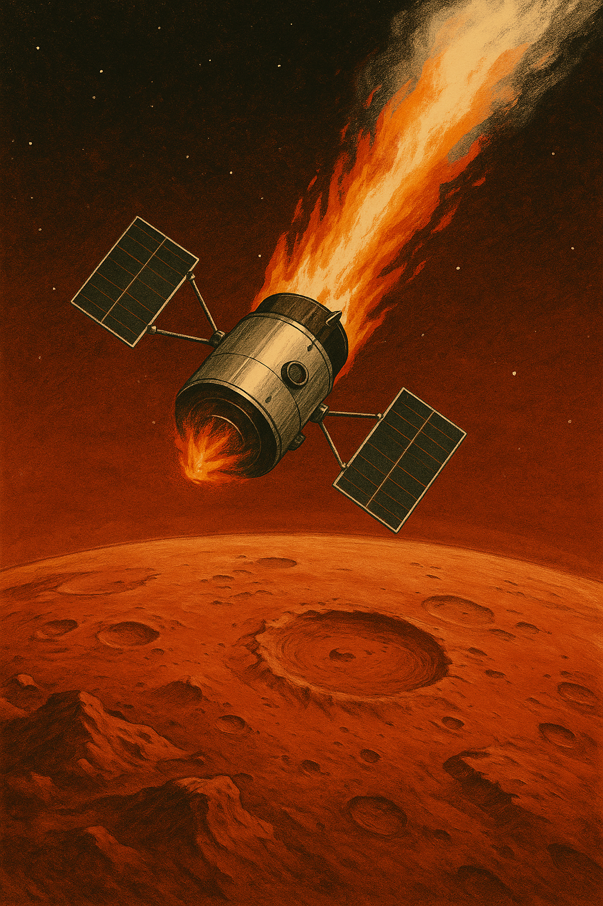
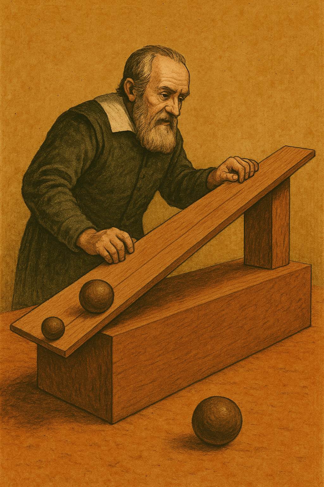
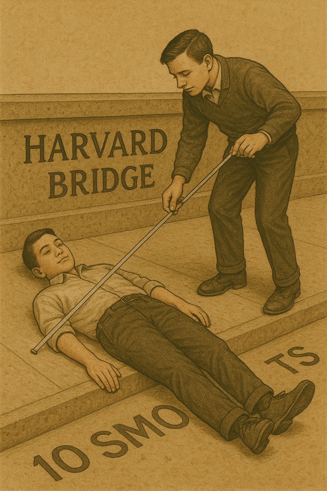
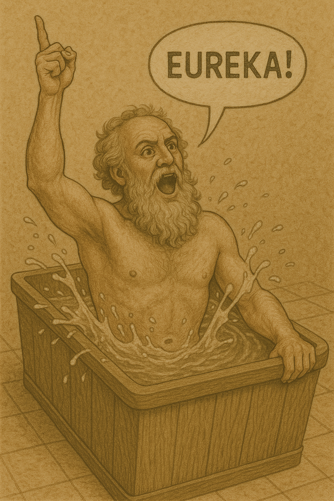

## General theory for this section

Physics is the Study of How the Universe Works, Physics explores the fundamental rules that govern matter, energy, space, and time. It helps explain everything from falling apples to black holes.

### SI Base Units

| Quantity            | Symbol | Unit Name | Unit Symbol |
|---------------------|--------|-----------|-------------|
| Length              | $l$    | meter     | m           |
| Mass                | $m$    | kilogram  | kg          |
| Time                | $t$    | second    | s           |
| Electric Current    | $I$    | ampere    | A           |
| Temperature         | $T$    | kelvin    | K           |
| Amount of Substance | $n$    | mole      | mol         |
| Luminous Intensity  | $I_v$  | candela   | cd          |

### Derived Units (Examples)

| Quantity | Symbol | Unit Name | Formula/Definition                           |
|----------|--------|-----------|----------------------------------------------|
| Force    | $F$    | newton    | $1\,\mathrm{N} = 1\,\mathrm{kg \cdot m/s^2}$ |
| Energy   | $E$    | joule     | $1\,\mathrm{J} = 1\,\mathrm{N \cdot m}$      |
| Power    | $P$    | watt      | $1\,\mathrm{W} = 1\,\mathrm{J/s}$            |
| Pressure | $P$    | pascal    | $1\,\mathrm{Pa} = 1\,\mathrm{N/m^2}$         |

### Common SI Prefixes

| Prefix | Symbol | Factor     | Example                |
|--------|--------|------------|------------------------|
| giga   | G      | $10^9$     | 1 GHz = $10^9$ Hz      |
| mega   | M      | $10^6$     | 1 MW = $10^6$ W        |
| kilo   | k      | $10^3$     | 1 km = $10^3$ m        |
| centi  | c      | $10^{-2}$  | 1 cm = $10^{-2}$ m     |
| milli  | m      | $10^{-3}$  | 1 ms = $10^{-3}$ s     |
| micro  | $\mu$  | $10^{-6}$  | 1 $\mu$F = $10^{-6}$ F |
| nano   | n      | $10^{-9}$  | 1 nm = $10^{-9}$ m     |
| pico   | p      | $10^{-12}$ | 1 pF = $10^{-12}$ F    |

### Unit Conversion

-   To convert between units with prefixes, multiply or divide by the appropriate power of ten.
-   Example: $5\,\mathrm{km} = 5 \times 10^3\,\mathrm{m} = 5000\,\mathrm{m}$

### Summary Table

| Quantity         | Symbol | Unit Symbol | Example with Prefix |
|------------------|--------|-------------|---------------------|
| Length           | $l$    | m           | 1 km = $10^3$ m     |
| Mass             | $m$    | kg          | 1 mg = $10^{-6}$ kg |
| Time             | $t$    | s           | 1 ms = $10^{-3}$ s  |
| Electric Current | $I$    | A           | 1 mA = $10^{-3}$ A  |
| Temperature      | $T$    | K           | —                   |
| Energy           | $E$    | J           | 1 kJ = $10^3$ J     |

## Stories to enritch

### The Mars Climate Orbiter Crash

{fig-align="center" width="50%"}

In 1999, NASA lost a \$125 million spacecraft because of a simple mistake: one team used imperial units while the other used metric. A force calculated in pound-seconds was interpreted as newton-seconds. The result? The probe entered Mars' atmosphere at the wrong angle and was destroyed. It’s a dramatic reminder that units really do matter — in space, there are no second chances.

### Fermi’s Paper Trick

At the first nuclear test in 1945, physicist Enrico Fermi dropped pieces of paper as the shockwave hit. By estimating how far they moved, he calculated the energy of the explosion — within a factor of two of the actual value. With no instruments, just logic and estimation, he showed how powerful order-of-magnitude thinking can be.

### Drag, Planes, and Pi

Before computers or wind tunnels, scientists wanted to understand what affects drag on an object. Using only dimensional analysis, they figured out how drag must depend on speed, fluid density, and surface area. This led to the discovery of the Reynolds number — a key idea in fluid dynamics. It all came from playing with units and looking for dimensionless combinations.

### Galileo Rolls the Ball

{fig-align="center" width="50%"}

Galileo rolled balls down a ramp and timed them with a water clock. He noticed the distance didn’t increase steadily — it grew faster and faster. He realized distance was proportional to time squared. It was one of the first steps toward understanding acceleration and laid the foundation for Newton’s laws — all from careful observation and simple timing.

### Maxwell’s Speed of Light

In the 1800s, James Clerk Maxwell found that the speed of electromagnetic waves could be calculated from two physical constants. When he worked it out, the speed matched that of light. Suddenly, light wasn’t just a mystery — it was a wave in electric and magnetic fields. Units helped reveal one of the most profound connections in physics.

From **Maxwell's equations** in vacuum (no charges, no currents), we can derive the wave equations for the electric and magnetic fields. Note that this is just for fun and is wayyy above A-Level:

$$
\nabla^2 \mathbf{E} = \mu_0 \epsilon_0 \frac{\partial^2 \mathbf{E}}{\partial t^2}
$$

$$
\nabla^2 \mathbf{B} = \mu_0 \epsilon_0 \frac{\partial^2 \mathbf{B}}{\partial t^2} 
$$

where:

-   ( $\mu_0$) = permeability of free space

-   ( $\epsilon_0$ ) = permittivity of free space

The general form of a wave equation is:

$$ \nabla^2 \psi = \frac{1}{v^2} \frac{\partial^2 \psi}{\partial t^2} $$

where ( v ) is the wave speed.

Comparing forms:

$$ \nabla^2 \mathbf{E} = \mu_{0} \epsilon_{0} \frac{\partial^2 \mathbf{E}}{\partial t^2} $$

we identify:

$$ v = \frac{1}{\sqrt{\mu_0 \epsilon_0}} $$

Since these are the equations for electromagnetic waves:

$$ \boxed{c = \frac{1}{\sqrt{\mu_0 \epsilon_0}}} $$

#### Constants

$$ \mu_0 = 4 \pi \times 10^{-7} \text{H/m} $$

$$ \epsilon_0 \approx 8.854187817 \times 10^{-12} \text{F/m} $$

Substituting:

$$ c = \frac{1}{\sqrt{ (4 \pi \times 10^{-7}) \times (8.854187817 \times 10^{-12}) }} $$

$$ =\boxed{299{,}792{,}458 \ \text{m/s}} $$

### How many tools does it take...

... To change a lightbulb? Two if you are in the International Space Station (ISS). The ISS was built by an international consortium which fostered collaboration but also led to some practical quirks. The modules built by the United States are made using Imperial units and fasteners, whilst the European, Russian and Japanese modules use the metric versions. Both metric and imperial tools have to be available for the astronauts.

### Banana equivalent dose

A unit used to provide an everyday measure of radiation dose. A single banana produces an ionising radiation dose of around 0.1 μSv which has been set as the value of the banana equivalent dose. The ionising radiation dose given by a range of sources can be expressed in BEDs. A Dental X-ray has a dose of 50 Bananas.

### The Smoot

{fig-align="center" width="50%"}

In 1958, Oliver R. Smoot, an MIT freshman, became an unlikely part of measurement history — and the basis of one of the most delightfully absurd units in physics: the smoot.

As part of a fraternity prank, Smoot’s brothers decided to measure the length of the Harvard Bridge (between Boston and Cambridge) using Smoot himself as the ruler. They had him lie down on the sidewalk, mark his position, then repeat — all the way across the bridge.

The final measurement? $364.4\text{ smoots} \pm 1\text{ ear}$.

Yes — they even included an uncertainty estimate. The "ear" was the estimated margin of error based on Smoot's slight squirming or misalignment during the process.

## Practical work and Demos

### Estimates of quantities

It is always important in Physics to have a rough idea of the values of quantities that you are attempting to measure. Introduce this idea by a set of intelligent guesses and fermi problems.

Fermi problems are estimation challenges named after physicist Enrico Fermi, who was known for making good approximate calculations with little or no actual data. These problems involve breaking down complex questions into simpler parts, making reasonable assumptions, and using estimation and logic to arrive at an approximate answer.

A classic example is: "How many piano tuners are there in Chicago?" To solve this, you’d estimate the population of Chicago, how many households might have pianos, how often they’re tuned, and how many tunings one person can do — then work your way to a rough answer.

Fermi problems develop skills in:

-   Critical thinking
-   Problem decomposition
-   Reasonable estimation
-   Handling orders of magnitude
-   They’re often used in science and engineering education to build confidence in tackling big or unfamiliar questions with limited data.

Having a physical sense of measurements can be very advantageous - especially in preparation for practical examinations (international exams only at time of writing). Try getting the students to:

-   guess the temperature of hot water (at about 50) in a bucket by feel
-   time 30s with eyes closed by counting against the clock.
-   the length of the lab just by looking at it
-   the height of a tree outside
-   the number of bricks in the wall of the lab

A really good demo for this is

#### Measuring Cylinders of Different Diameters

##### Setup:

Two measuring cylinders, one with twice the diameter of the other. Pour a certain volume from the larger into the smaller.

##### Question:

How high will the liquid be in the smaller cylinder?

##### Answer:

-   4 times higher, if diameter ratio is 2:1.
-   Great for pointing out the use of ratio and fractions even in qualatative questions.

##### Variant: Two martini glasses

###### Setup:

Fill two martini glasses to 1/2 their volume full of water or any other liquid. They will look 3/4 full.

###### Question:

What will happen when one is emptied into the other?

###### Answer:

The glass fills exactly to it’s full height - a very suprising lesson in shape volume.

::::::: {.callout-note collapse="true"}
## Practical Info:

:::::: columns
::: {.column width="45%"}
**Equipment**

-   Measuring cylinder A
-   Measuring cylinder B, half the diameter of A

or:

-   Two Martini glasses
-   Coloured Water

Note: Make sure you have enough volume in the smaller cylinder for all the water...
:::

::: {.column width="10%"}
<!-- empty column to create gap -->
:::

::: {.column width="45%"}
**Age range / Keystage**

KS3:  {{\< fa star \>}}

KS4:   

KS5:   
:::
::::::
:::::::

### Dimensional analysis

Dimensional analysis is a powerful method used in science and engineering to check equations, derive relationships, and convert between units. It’s based on the principle that physical quantities must be dimensionally consistent — meaning both sides of an equation must have the same basic units (such as mass $M$, length $L$, time $T$, etc.).

For example, speed has dimensions of distance divided by time, $D/T \text{ or } DT^{-1}$. If you’re given an equation involving speed, distance, and time, dimensional analysis can help you verify if it’s physically meaningful.

Key uses of dimensional analysis include:

-   Checking equations for consistency
-   Deriving formulas when the exact relationship isn’t known
-   Converting units (e.g. km/h to m/s)
-   Estimating outcomes in physics problems

It’s a valuable tool for spotting errors and making sense of unfamiliar problems using just the units involved.

### Getting values for the sizes of small quantities

The sizes of small measurements (mass or length) can best be found by measuring a large number of the objects and then dividing the result by the number of objects. This technique is one of the few that *reduces* uncertainty.

For example:

The thickness of a sheet of paper is best found by measuring the thickness of a number of sheets. if 10 of them are found to be 1.10mm $\pm$ 0.01mm then the thickness is 0.11mm $\pm$ 0.001mm.

The volume of a marble can be accurately found by measuring the diameter of five of them in a line.

The mass of a single small ball bearing can be found by measuring the mass of a known large number of them.

::::::: {.callout-note collapse="true"}
## Practical Info:

:::::: columns
::: {.column width="45%"}
**Equipment**

-   Ream of paper
-   Jar of marbles
-   Rulers
-   Top-pan balance
:::

::: {.column width="10%"}
<!-- empty column to create gap -->
:::

::: {.column width="45%"}
**Age range / Keystage**

KS3:  

KS4:   

KS5:     
:::
::::::
:::::::

### Simple measurements in Physics

As an introduction to measurement get the pupils to measure:

-   The volume of a microscope slide
-   The distance between two holes in an A4 sheet
-   The area of an A4 sheet
-   The diameter of a ball bearing
-   The volume of a slotted 100g mass etc.

Prepare both large and small shapes on which to experiment.

::::::: {.callout-note collapse="true"}
## Practical Info:

:::::: columns
::: {.column width="45%"}
**Equipment**

-   Microscope slides
-   A4 and A3 paper etc
-   Rulers, vernier and micrometers
-   Selection of different size balls
:::

::: {.column width="10%"}
<!-- empty column to create gap -->
:::

::: {.column width="45%"}
**Age range / Keystage**

KS3:  

KS4:   

KS5:     
:::
::::::
:::::::

### Measuring Distance Accurately

In the course of learning physics students need to learn the art of precision measurements. Use a variety of measuring instruments (Metre ruler, Vernier caliper, Micrometer) to measure small objects (e.g., pencil, bolt). Try not to use tools with a digital readout until the concept of a vernier scale is solidly understood.

There's a great model of [a micrometer here](https://iwant2study.org/lookangejss/01_measurement/ejss_model_Micrometer02/Micrometer02_Simulation.xhtml) and [a vernier caliper here](https://iwant2study.org/lookangejss/01_measurement/ejss_model_AAPTVernierCaliper/)

The concepts of precision, scale reading, and significant figures are critical. Have students measure the same object with ruler, caliper, and micrometer.

Discuss:

-   Zero error - the error that occurs when a measuring instrument shows a reading *other than zero* when it should actually read zero.

<!-- -->

-   Precision - Precision refers to how *closely repeated measurements of the same quantity agree with each other*.

-   Uncertainty - Uncertainty is an estimate of the range within which the true value of a measured quantity is expected to err, and...

-   When to use which tool:

    | Tool | Typical precision | Suitable for | Example uses |
    |------------------|------------------|------------------|------------------|
    | **Ruler** | ±1 mm (0.1 cm) | Measuring lengths where high precision is *not* needed | Width of a book, length of a pencil, height of a table |
    | **Vernier caliper** | ±0.1 mm (0.01 cm) | Measuring external & internal dimensions and depths with moderate precision | Diameter of a pipe, thickness of a metal sheet, inner diameter of a hole |
    | **Micrometer** | ±0.01 mm (0.001 cm) | Measuring very small dimensions with high precision | Thickness of a wire, diameter of a small sphere, thickness of a thin sheet |

### Stopwatch Reaction Time

Human reaction time is only accurate to about $\pm 0.3s$. You can explore this effectively with the ruler drop test.

1.  One person holds the ruler vertically so that:

-   The 0 cm mark is at the bottom.

-   The ruler is positioned between the thumb and forefinger of the catcher, but *not touching*.

2.  The catcher gets ready, with their fingers open.
3.  Without warning, the holder releases the ruler.
4.  The catcher closes their fingers as quickly as possible to catch the ruler.
5.  Record the measurement on the ruler at the point where it was caught (this is the distance fallen).

Use the equation of motion for free fall:

$$
s=1/2gt^{2}
$$

where:

-   s = distance the ruler fell (m)

-   g = acceleration due to gravity (≈ 9.81 m/s²)

-   t= reaction time (s)

Rearrange:

$$t=\sqrt{\frac{2s}{g}}$$​​

::::::: {.callout-note collapse="true"}
## Practical Info:

:::::: columns
::: {.column width="45%"}
**Equipment**

-   Rulers
-   Stopwatches
:::

::: {.column width="10%"}
<!-- empty column to create gap -->
:::

::: {.column width="45%"}
**Age range / Keystage**

KS3:  

KS4:   

KS5:     
:::
::::::
:::::::

### Mass and Balance: Using a Top Pan Balance

Another essential skill for students to learn is how to use a top-pan balance - usually referred to (incorrectly) as scales. The concepts of: Mass, precision, taring (setting the readout to zero *after* placing a container or any item you don't want to include in the measurement) and units (grams/kilograms) are all useful areas to explore. This is another opportunity to discuss Zero error, resolution of the scale (±0.01 g etc).

::::::: {.callout-note collapse="true"}
## Practical Info:

:::::: columns
::: {.column width="45%"}
**Equipment**

-   Selection of masses
-   Top-pan balance
:::

::: {.column width="10%"}
<!-- empty column to create gap -->
:::

::: {.column width="45%"}
**Age range / Keystage**

KS3:  

KS4:   

KS5:     
:::
::::::
:::::::

### Water Displacement for Volume

{fig-align="center" width="50%"}

Over 2,000 years ago, in ancient Greece, the king asked Archimedes to solve a problem: Was his new crown made of pure gold — or had the goldsmith cheated by mixing in cheaper metals?

Archimedes thought hard, but couldn’t figure out how to test it without damaging the crown. One day, while lowering himself into a full bath, he noticed the water overflowed. At that moment, he realised:

> An object displaces its own volume of water. He had found a way to measure the crown’s volume — without melting it.

Excited, he jumped out of the bath and ran through the streets shouting:

> “Eureka!” or “I have found it!”

Using water displacement to find the volume of irregular objects is a fantastic opportunity to teach how to measure volume and parallax error etc.

1.  **Fill the displacement can:**\
    Fill the can with water until water just starts to flow out of the spout. Wait until it stops dripping — the can is now full to the spout level.

2.  **Place a measuring cylinder under the spout.**\
    Make sure it’s ready to catch any displaced water.

3.  **Gently lower the object into the can.**

    1.  Make sure no water splashes out (that would give error).
    2.  Ensure the object is completely submerged.

4.  **Collect the displaced water in the cylinder.**\
    The water that overflows equals the volume of the object.

5.  **Read the volume of water collected.**\
    This is the volume of the object (since: $\text{volume of object} = \text{volume of displaced water}$ )

    Example: If the measuring cylinder shows: $75 \ \text{ml}$ then the volume of the object is $75 \ \text{cm}^3$

::::::: {.callout-note collapse="true"}
## Practical Info:

:::::: columns
::: {.column width="45%"}
**Equipment**

-   Measuring cylinder,
-   Irregular objects,
-   Large beakers or eureka cans
-   Water
:::

::: {.column width="10%"}
<!-- empty column to create gap -->
:::

::: {.column width="45%"}
**Age range / Keystage**

KS3:  

KS4:   

KS5:     
:::
::::::
:::::::

### Error Bars on a Graph

Particularly at a-level, the students need to be able to do simple linear regression and plot lines of maximum and minimum gradient.

When opportunity presents - eg. wuth simple experiments like Hooke's Law, have students plot mean values with error bars from the accuracy of their instruments, or from repeated trials.
