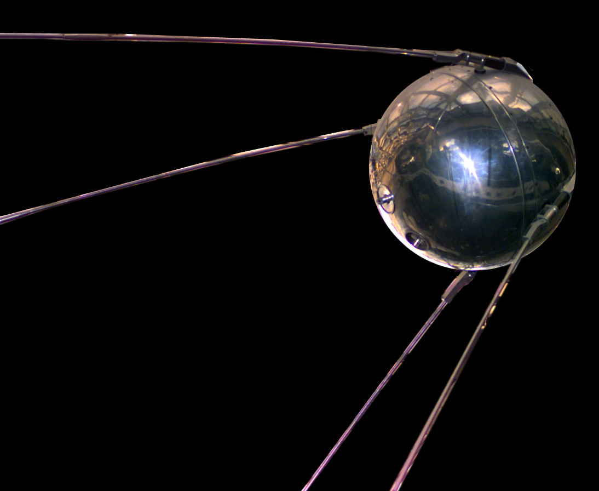
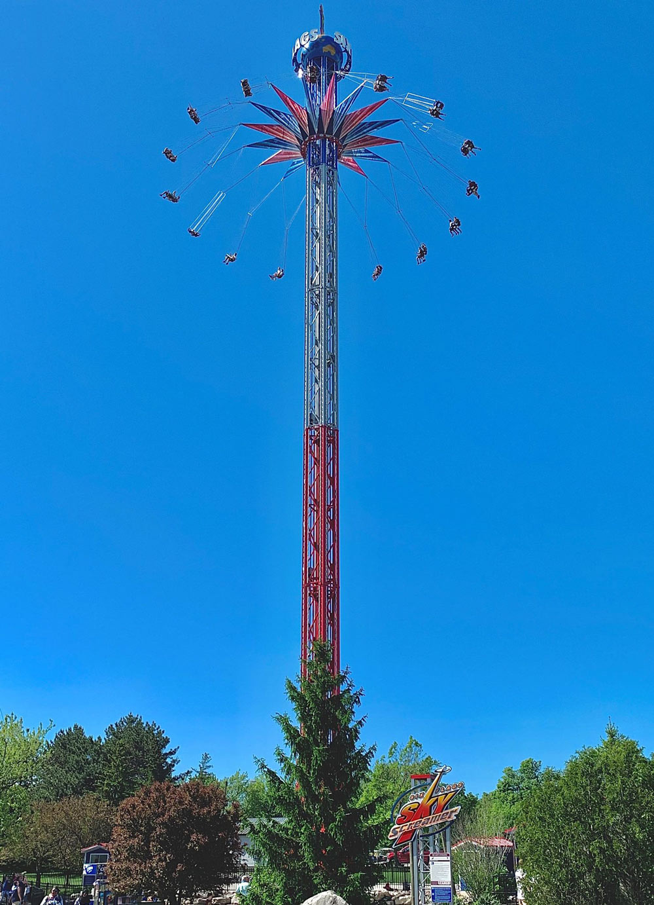
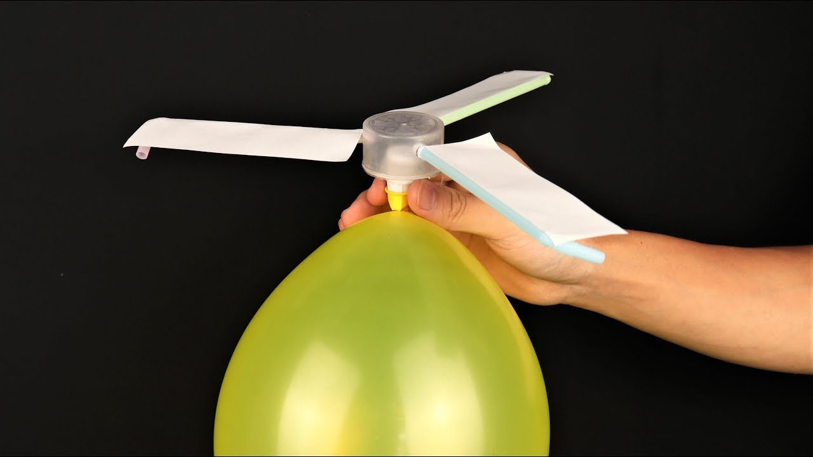
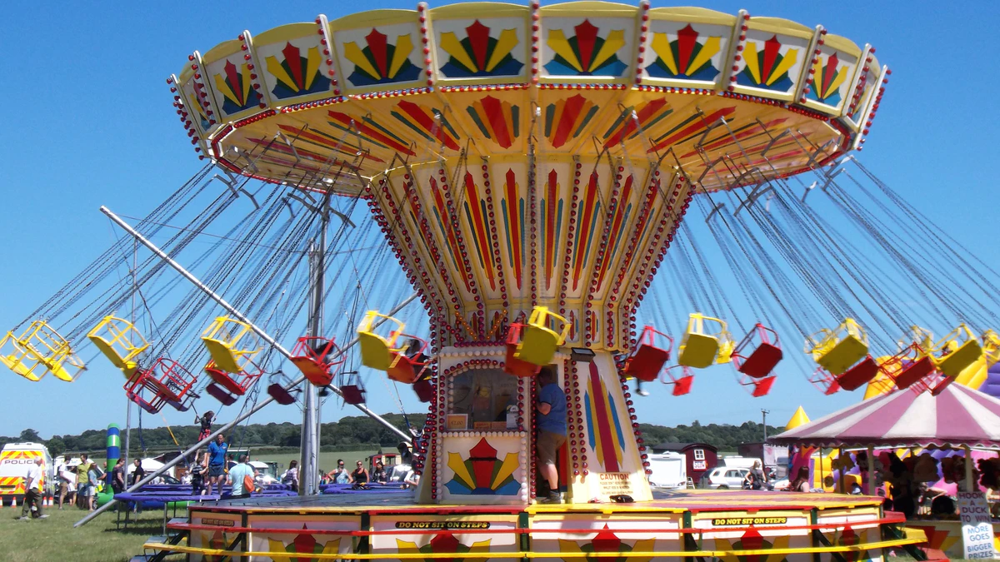
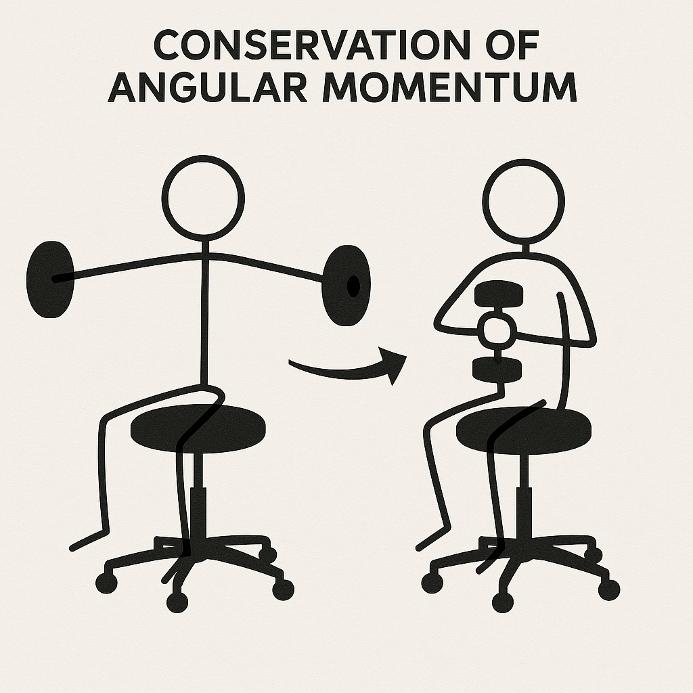
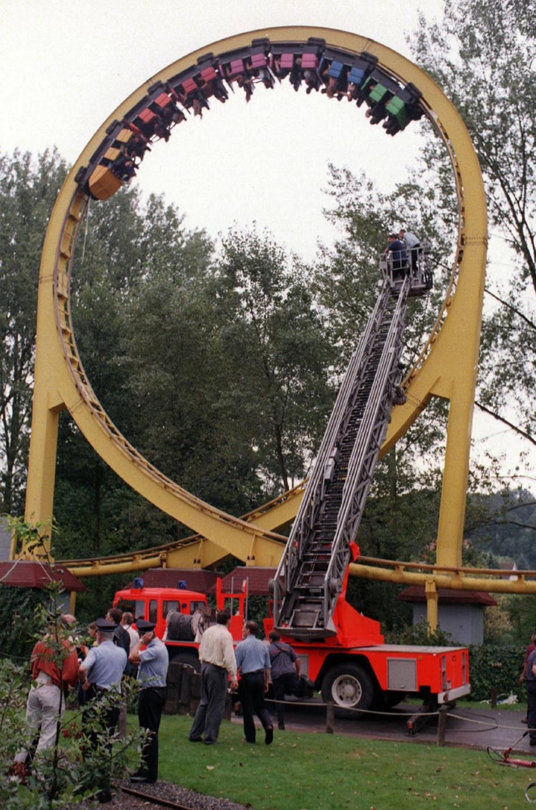

## General theory for this section:

### Definition

Circular motion refers to the movement of an object along the circumference of a circle. It can be **uniform** (constant speed) or **non-uniform** (changing speed), but in both cases the **direction of motion changes continuously**, implying **acceleration**.

### Key Quantities

| Quantity | Symbol | Units | Description |
|------------------|------------------|------------------|------------------|
| Radius | $r$ | m | Distance from the center to the object |
| Speed | $v$ | m/s | Magnitude of the velocity (scalar) |
| Angular velocity | $\omega$ | rad/s | Rate of rotation: $\omega = \frac{d\theta}{dt}$ |
| Frequency | $f$ | Hz | Revolutions per second: $f = \frac{1}{T}$ |
| Period | $T$ | s | Time for one complete revolution |
| Centripetal acceleration | $a_c$ | m/s² | Directed toward the center: $a_c = \frac{v^2}{r}$ |
| Centripetal force | $F_c$ | N | Net force causing circular motion: $F_c = \frac{mv^2}{r}$ |

### Key Relationships

-   $v = \omega r$
-   $a_c = \omega^2 r = \frac{v^2}{r}$
-   $F_c = ma_c = m\omega^2 r = \frac{mv^2}{r}$

### Direction of Vectors

-   **Velocity** is **tangential** to the circle.
-   **Acceleration** and **centripetal force** point **toward the center**.
-   There is **no outward force** acting on the object (e.g., "centrifugal force" is a **fictitious** force in an inertial frame).

### Examples

-   A car turning around a bend
-   A satellite orbiting Earth
-   An electron moving in a magnetic field
-   A mass on a string swung in a horizontal circle

Centripetal force is the force that pulls or pushes an object from its straight-line path. It always acts towards the centre of a circle. The centrifugal force is the reaction of this force on the thing doing the pushing or pulling but not on the rotating object itself.

$$
\text{Centripetal force} = \frac{mv^{2}}{R}
$$

where:

-   $m$ is the mass of an object moving at a constant speed

-   $v$ is the tangential velocity

-   $R$ is the radius of the circle round a circle of radius R

## Stories to enrich

### Sputnik and the Start of Space Orbits (1957)

{fig-align="center" width="50%"}

When the Soviet Union launched Sputnik, the first artificial satellite, it stunned the world — and illustrated circular motion on a planetary scale.

Sputnik stayed in orbit because it was moving sideways fast enough (about 8 km/s) that Earth's surface curved away beneath it as it "fell." It didn't need engines to stay up — just the right speed to balance gravity with inertia, a perfect case of centripetal motion. Circular motion wasn’t just theory anymore — it became the basis of satellite technology, GPS, and global communication.

### The World’s Tallest Swing Ride

The StarFlyer ride in Florida lifts passengers nearly 150 meters into the air and spins them around at over 70 km/h.

{fig-align="center" width="50%"}

Despite being "thrown outward," riders are actually being pulled inward by the tension in the cables — providing the centripetal force. If the cables broke, the rider wouldn’t fly outward — they'd follow a tangent path, showing Newton’s first law in action. It’s thrilling — and a real-life demonstration of circular motion and Newtonian mechanics.

### The Spinning Space Station Idea (2001: A Space Odyssey)

In the film 2001: A Space Odyssey, the rotating space station creates artificial gravity by spinning. This isn’t just science fiction — it's real physics.



In a spinning ring, objects are forced against the outer wall by their inertia. The wall provides the centripetal force, which feels like gravity to the occupants. Engineers have seriously considered building rotating space habitats using this principle to help astronauts stay healthy in zero gravity.

## Practical work and Demos

### The flying pig...

The theory of circular motion, or indeed, the conical pendulum can be demonstrated wonderfully with this ornithopter toy. The battery drives the mechanism causing the pig to fly in a circle of radius r at a constant speed. It is also a good simulation of the chairs in fairground rides.

{fig-align="center" width="40%"}

The faster the pig the bigger the angle (0) that the string makes with the vertical. Measurements of 0, v, m and r are easy to make, and so the experiment could be used to find the acceleration due to gravity (g).

For a pig of mass $m$, resolving vertically:

$$ mg = T \cos \theta $$

Resolving horizontally:

$$\frac{mv^{2}}{r} = T \sin \theta$$ Therefore: $$ \frac{mv^{2}}{r} \tan \theta = mg $$ and so

$$g = \frac{v^{2}}{r} \tan \theta $$

::::::: {.callout-note collapse="true"}
## Practical Info:

:::::: columns
::: {.column width="45%"}
**Equipment**

-   Flying pig toy
-   Stopwatch
-   Ruler
:::

::: {.column width="10%"}
<!-- empty column to create gap -->
:::

::: {.column width="45%"}
**Age range / Keystage**

KS3: 

KS4:  

KS5:    
:::
::::::
:::::::

### Whirling bucket

The classic centripetal force experiment;

-   Put a little water in a plastic bucket
-   get hold of bucket and then swing the bucket in a vertical circle.

As long as the rate of rotation is great enough the water stays in the bucket. Slowing the rate of rotation can get the water to almost fall out at the top of the path, and you can hear it slopping around at this critical point.

Mention that the water and bucket experience a centripetal force, but that there is also a centrifugal force - this is the reaction on the pivot, in this case your hand. Many extensions of this are possible, such as swinging a tray loaded with beakers by four strings!

Note: Do not swing it so fast so that the handles of the bucket come off, you'll get soaking (guess how I know...) and ensure that the bucket does not hit the floor at the lowest point of the circle. For the sake of safety it's best not to use a metal bucket ot too much water.

::::::: {.callout-note collapse="true"}
## Practical Info:

:::::: columns
::: {.column width="45%"}
**Equipment**

-   Bucket (plastic)
-   Water
:::

::: {.column width="10%"}
<!-- empty column to create gap -->
:::

::: {.column width="45%"}
**Age range / Keystage**

KS3:  {{\< fa star \>}}

KS4:   

KS5:   
:::
::::::
:::::::

### Balloon Helicopter

This is a great toy for demonstrating some effects of rotation and Newtonian forces that's easy to make with a sports bottle lid and a few straws or cheaply purchased from most toy shops.

{fig-align="center" width="50%"}

The balloon is inflated, attached to the lid, and allowed to deflate pushing air through the straws. By angling the ends of the straws the toy spins - so it flies in a stable fashion - and the vertical component lifts the toy high in the air.

::::::: {.callout-note collapse="true"}
## Practical Info:

:::::: columns
::: {.column width="45%"}
**Equipment**

-   Bucket (plastic)
-   Water
:::

::: {.column width="10%"}
<!-- empty column to create gap -->
:::

::: {.column width="45%"}
**Age range / Keystage**

KS3:  {{\< fa star \>}}

KS4:   

KS5:   
:::
::::::
:::::::

### Fruit bowl "wall of death"



This demonstration is a simulation of a motorcyclist on a wall of death at a fairground. Take a glass or plastic fruit bowl of diameter at least 30 cm to represent the Wall of Death and a toy car to represent the motor cyclist. With a little practice the car can be made to roll round the sides of the bowl and once moving can be kept going by a small oscillation of the bowl.

::::::: {.callout-note collapse="true"}
## Practical Info:

:::::: columns
::: {.column width="45%"}
**Equipment**

-   Mixing bowl (glass or clear plastic)
-   Small toy car (micromachine) or ball-bearing
:::

::: {.column width="10%"}
<!-- empty column to create gap -->
:::

::: {.column width="45%"}
**Age range / Keystage**

KS3:  {{\< fa star \>}}

KS4:   

KS5:   
:::
::::::
:::::::

### Wine glass and grape

This is a classic bar-trick; You challenge someone to pick up a small object — traditionally a grape, but sometimes a cherry or olive (I tend to use a marble in the lab) — from the table using only an empty wineglass *without* touching the grape directly with your hands or the rim of the glass.

-   Place the grape on a smooth table.

-   Hold the wineglass upside down so that the rim is very close to — but not touching — the grape.

-   Start rotating the glass in small, smooth horizontal circles above and around the grape, gradually tightening the circles so that the grape begins to roll or slide toward the center under the glass.

-   As the grape comes under the glass and picks up speed, increase the circular speed of the glass. The grape stays inside the glass due to the inward centripetal force and the upward component of the reaction due to the shape of the glass.

-   Once the grape is securely spinning inside the bowl of the glass, you can smoothly lift it off the table while still circling.

::::::: {.callout-note collapse="true"}
## Practical Info:

:::::: columns
::: {.column width="45%"}
**Equipment**

-   Wine glass
-   Grape or marble
:::

::: {.column width="10%"}
<!-- empty column to create gap -->
:::

::: {.column width="45%"}
**Age range / Keystage**

KS3:  {{\< fa star \>}}

KS4:   

KS5:   
:::
::::::
:::::::

### The Chair-O-Plane

{fig-align="center" width="50%"}

This fairground ride is more common/popular in the US but can also be found at the more traditional "steam fair" type events in the UK. It makes for a fantastic application of centripetal force and resolving vectors.

Consider the vertical component of rider and chair:

$$
\text{Tension in wire} = \frac{mg}{\cos \theta}
$$

and

$$
F_{centripetal} = \frac{mv^{2}}{r} = \text{Tension in the wire} \times \sin \theta
$$

Where:

-   $v$ is the linear velocity

-   $mg$ is the mass of rider and chair

-   $\theta$ is the angle the chairs make to the vertical.

This can be used to show that all the chairs swing out the same amount regardless of their mass. A model can be made easily with a disc and an electric drill.

### The Rotor



The rotor is another fantastic fairground ride for illustrating circular motion and friction - Very much like the wall of death.

### Sparkler in a drill

Possibly the greatest demonstration in all of physics;

-   Put sparkler in chuck of electric drill
-   Light
-   SPIN!

Experiment with different rates of revolution for maximum effect. The hot bit of the sparkler will be seen to travel in a circle whilst those sparks that fly-off will be seen to follow a tangent into a parabolic arc. A wonderful demonstration of projectiles and circular motion.

Note on safety:

-   if you're indoors, make sure the sparkler's are the indoor variant.
-   Make sure that nobody is in the plane of the sparkler's revolution, bits can break off travelling at quite a high speed.
-   Handle the used sparkler with care till cool and dispose of safely.

::::::: {.callout-note collapse="true"}
## Practical Info:

:::::: columns
::: {.column width="45%"}
**Equipment**

-   Cordless Drill
-   Sparkler (indoor if doing indoors!)
:::

::: {.column width="10%"}
<!-- empty column to create gap -->
:::

::: {.column width="45%"}
**Age range / Keystage**

KS3:  {{\< fa star \>}}

KS4:   

KS5:   
:::
::::::
:::::::

### Spinning office chair

{fig-align="center" width="50%"}

Sit on a rotating chair holding two heavy masses and spin slowly. Quickly draw your arms in to show the effect of conservation of angular momentum. Stretching out will slow you down again.

With a low-friction chair this can be extremely impressive. I like to back this up with video footage of ice-skaters spinning. Students can easily spot the manipulations of the distribution of mass when they know what to look for.

::::::: {.callout-note collapse="true"}
## Practical Info:

:::::: columns
::: {.column width="45%"}
**Equipment**

-   Wheely chair or rotating platform
-   Weights/dumbells
:::

::: {.column width="10%"}
<!-- empty column to create gap -->
:::

::: {.column width="45%"}
**Age range / Keystage**

KS3:  {{\< fa star \>}}

KS4:   

KS5:   
:::
::::::
:::::::

### The wire coat hanger and circular motion

Pull open a wire coat hanger so that it forms a square. File the end of the hook flat and then bend the hook until it points towards the opposite corner of the square. Balance a Ip coin on the hook, put one finger in the corner of the square opposite the hook and then spin the coat hanger in a vertical circle - the coin stays in place! This is a very simple but excellent demonstration of centripetal force.

The force of the hook on the penny always acts towards the centre of rotation.

With only a little practice you will be able to start and stop the spin at your leisure.

::::::: {.callout-note collapse="true"}
## Practical Info:

:::::: columns
::: {.column width="45%"}
**Equipment**

-   Coathanger - the wire type
-   File
-   Pliers
-   Coins
:::

::: {.column width="10%"}
<!-- empty column to create gap -->
:::

::: {.column width="45%"}
**Age range / Keystage**

KS3:  {{\< fa star \>}}

KS4:   

KS5:   
:::
::::::
:::::::

### Rotating candle

On a turntable put a candle shielded by a glass tube such as a jam jar the candle must be shorter than the height of the jar. Light the candle and rotate the turntable. Watch the flame! (A table with a diameter of 30 cm and a rotation rate of about 1 Hz is appropriate.)

::::::: {.callout-note collapse="true"}
## Practical Info:

:::::: columns
::: {.column width="45%"}
**Equipment**

-   Turntable
-   Candle
-   Glass jar to sheild flame
:::

::: {.column width="10%"}
<!-- empty column to create gap -->
:::

::: {.column width="45%"}
**Age range / Keystage**

KS3:  {{\< fa star \>}}

KS4:   

KS5:   
:::
::::::
:::::::

### Rotating jelly - circular motion

The effects of centripetal forces on a rotating object can be shown impressively by making a circular jelly about 3 cm deep in a crystallising dish. When it is set empty it out carefully on to the centre of a polystyrene plate which is securely fixed to the centre of the plywood platform.

Slowly increase the rate of spin of the table. The jelly will flatten.

Further increasing the rate of spin will eventually make the jelly break up - the cohesive forces within it being less than the centripetal forces needed. It can be used to demonstrate why car tyres fly apart when they are spun too fast.

The jelly experiment also shows the shape of the liquid surface while rotating. It is useful to photograph it or take a video for later analysis.

::::::: {.callout-note collapse="true"}
## Practical Info:

:::::: columns
::: {.column width="45%"}
**Equipment**

-   Wooden plate with bolt through central hole for mounting in drill
-   Jelly mould
:::

::: {.column width="10%"}
<!-- empty column to create gap -->
:::

::: {.column width="45%"}
**Age range / Keystage**

KS3:  {{\< fa star \>}}

KS4:   

KS5:   
:::
::::::
:::::::

### Vertical circles

If a bung is being swung round on a string in a vertical circle at a constant speed the centripetal force must be constant, but because the object has weight ($mg$), the string tension vaies.

The tension provides part of the centripetal force as it goes round the top of the loop and provides a supporting force *and* the centripetal force at the bottom of the loop.

At the bottom of the circle:

$$ T_{string}  - mg = \frac{mv^{2}}{r}$$ So.. $$T_{string}  = \frac{mv}{r} + mg $$

At the sides of the circle: $$ T_{string} = \frac{mv^{2}}{r}$$ At the top of the circle:

$$ T_{string} + mg = mv^{2}/r $$

so

$$ T_{string}  = \frac{mv^{2}}{r} - mg $$ \#### Bonus story:

An outside loop is an aerobatic maneuver in which an aircraft flies a circular path with the canopy on the outside of the circle, as opposed to a normal or inside loop where the pilot stays on the inside of the circle. In a typical inside loop, positive G-forces push the pilot into the seat, but in an outside loop the pilot experiences negative G-forces that try to pull them out of the seat, placing immense strain on both the pilot’s body and the aircraft.

The outside loop was first successfully performed in 1927 by American pilot Jimmy Doolittle, who flew a Curtiss P-1C Hawk biplane. At the time, many believed the stunt was impossible or suicidal due to the extreme negative G-forces involved, but Doolittle’s achievement marked a milestone in aviation history, proving both the strength of modern aircraft and the resilience of skilled pilots. Outside loops are particularly challenging because the negative G-forces, which can reach minus three to minus five G or more, can cause great discomfort, vision problems such as red-out, or even loss of consciousness.

The aircraft itself must be strong enough to withstand these forces without structural failure, and the pilot must exert precise control to avoid dangerous spins or crashes. Today, outside loops are a standard element in aerobatic competitions and displays, but they remain a demanding test of both machine and pilot, showcasing advances in aircraft engineering and human endurance.

### Toy cars, loop the loop

Toy cars on a plastic track can be used to demonstrate a number of ideas in mechanics. If the track can be bent into a vertical circle then loop the loop experiments can be performed.

The problem of "will it make it round?" can be approached as follows:

The Centripetal force is provided by a combination of the reaction of the track (R) and the force of gravity (mg). At the top of the path the car can travel at its minimum speed since the centripetal force can be provided by gravity alone.

The minimum reaction occurs at the top of the path where:

$$\frac{mv_{t}^{2}}{r} = mg $$ So $$
v_{t} = \sqrt{gr}
$$ where: - $r$ is the radius of the loop. - $v_t$ is the velocity at the top of the loop.

so far we have worked out the minimum speed that maintains contact with the loop. To work out the minimum entry speed ($v_e$) we need to use conservation of energy:

Assuming the car *just* makes it up a loop of height $2r$ (where $r$ is the radius of the loop), the gain in GPE is $mgh$ so the minimum speed is ;

$$ mg \times 2r = 1/2mv_{e}^{2} + 1/2mv_{t}^{2}$$ substituting $v_{t}^{2} = gr$ $$
mg \times 2r = 1/2mv_{e}^{2} + 1/2mgr
$$ Cancel $m$;

$$
g \times 2r = 1/2v_{e}^{2} + 1/2gr
$$

so $$
v_{e} = \sqrt{5gr}$$

The illustration below shows the rare incident in 1997, when a rollercoaster got stuck in a middle of a loop, leaving riders stuck upside down. It was revealed later that a component of the launch system had broken, leading to the insufficient speed. Experts described the train’s stalling at the loop’s apex as a rare occurrence of perfect balance

{fig-align="center" width="50%"}

::::::: {.callout-note collapse="true"}
## Practical Info:

:::::: columns
::: {.column width="45%"}
**Equipment**

-   Toy car
-   Plastic "Hotwheels" type track
:::

::: {.column width="10%"}
<!-- empty column to create gap -->
:::

::: {.column width="45%"}
**Age range / Keystage**

KS3:  {{\< fa star \>}}

KS4:   

KS5:   
:::
::::::
:::::::
