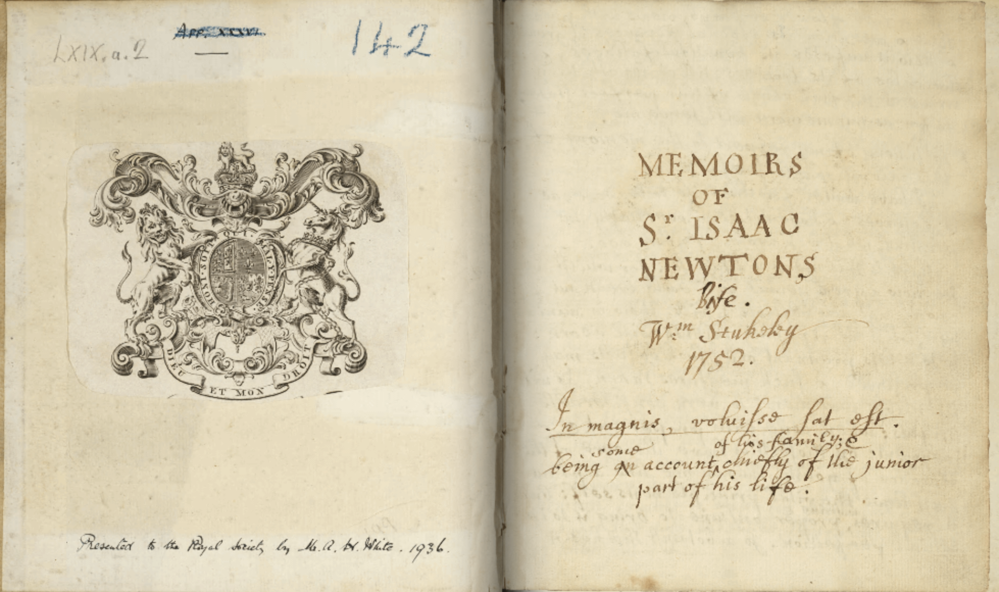
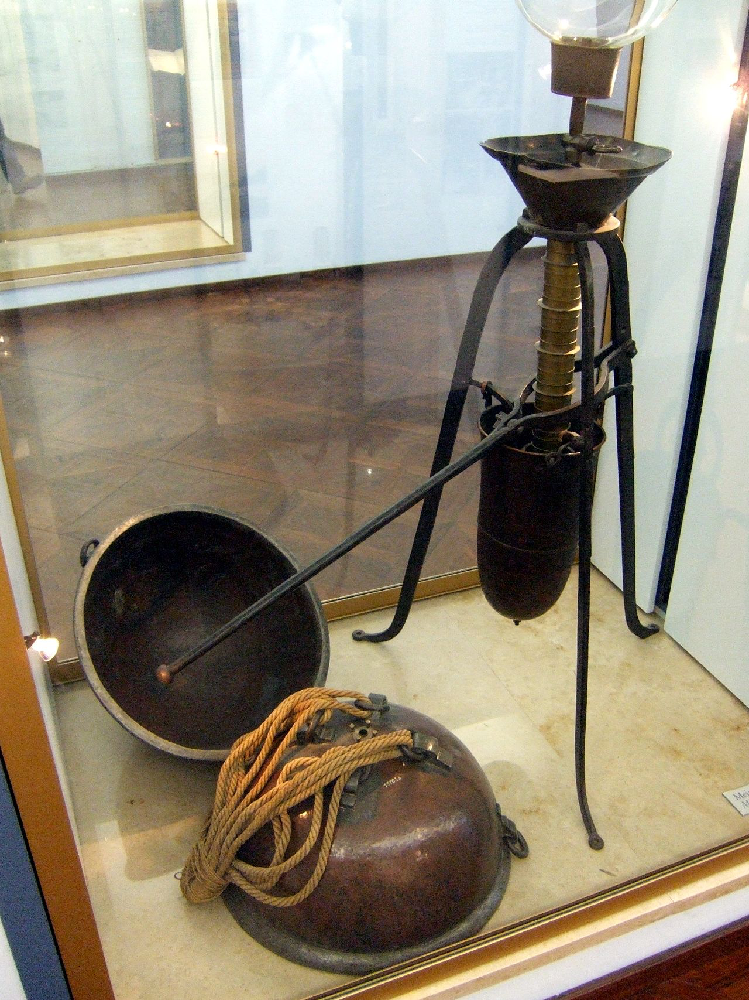
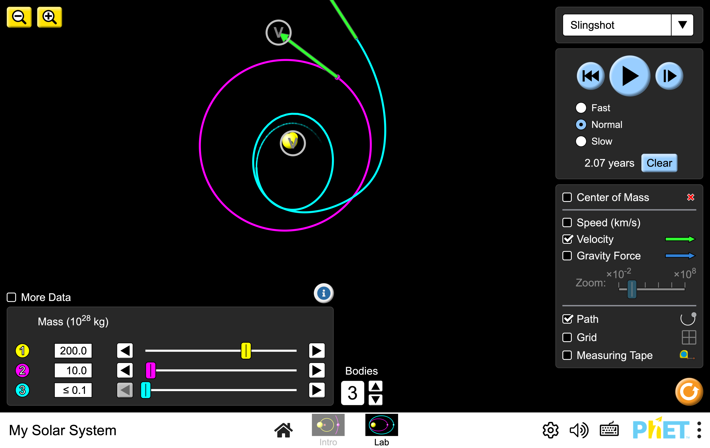
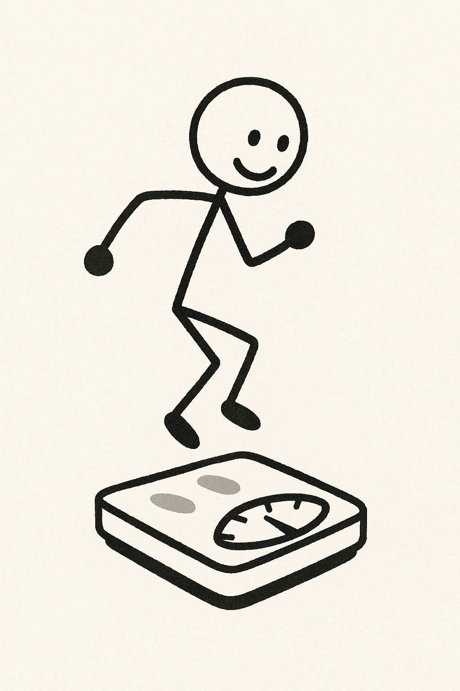
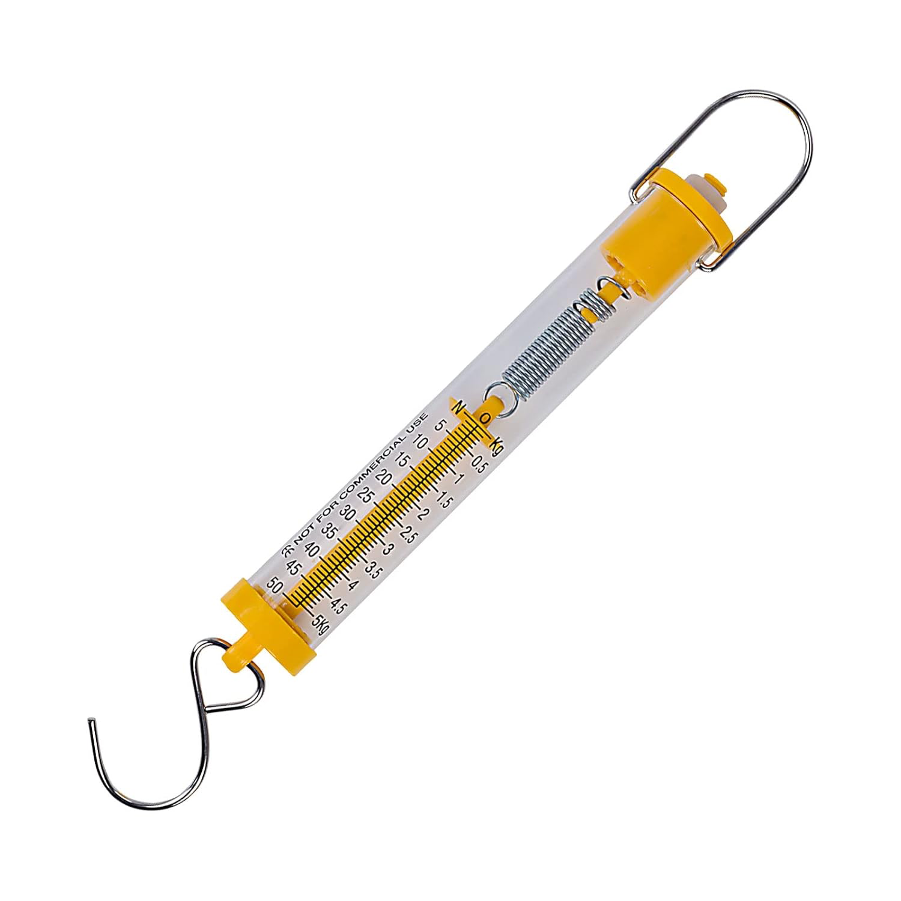
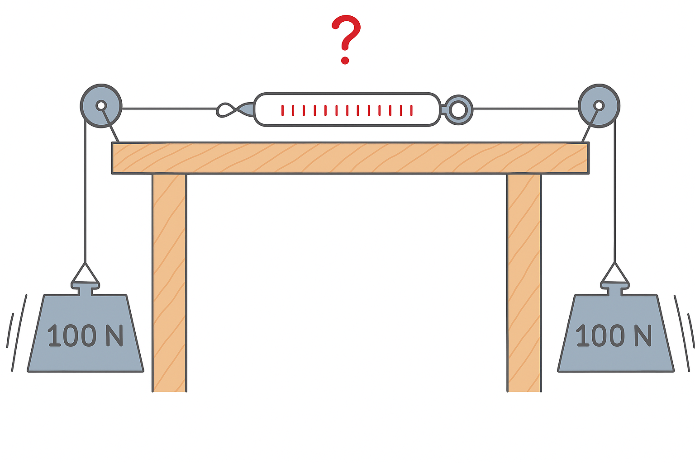
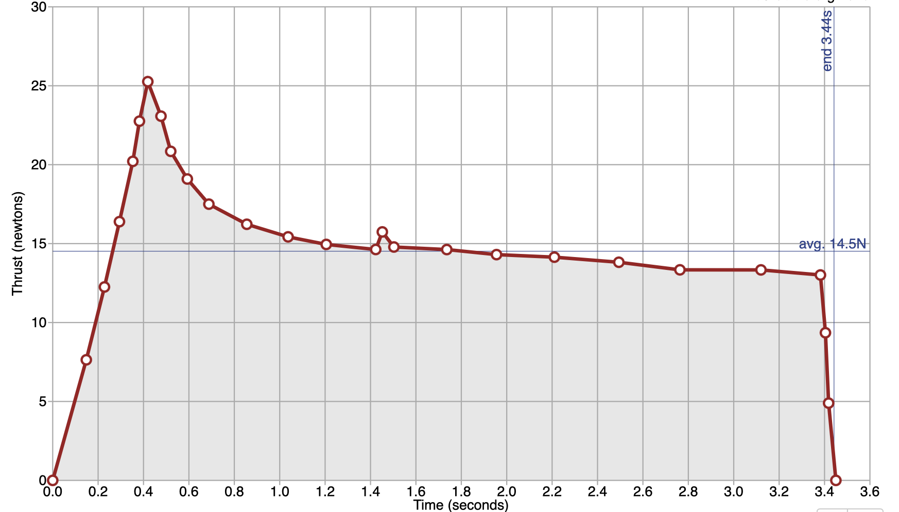

## Basic Theory

The size of a force is measured in units called Newtons (N). You can get a rough idea of a force's size by thinking about the pull of the Earth on us.

### Mass

This is the amount of stuff (matter) in an object. It is measured in kilograms (kg) and is always the same wherever the object is. The only way to change the mass of something is to chip a bit off! (Ignoring relativistic effects of course.)

### Weight

The force of attraction of the Earth on us is our WEIGHT. The more massive we are the bigger is the force of attraction and the bigger is our weight. This also gives us a rough definition of the Newton.
A Newton is the pull of the Earth on about 100 g. The pull of the Earth on 1 kg is about 10 N.

### Newton’s First Law (Law of Inertia)

-   An object remains at rest or moves with constant velocity unless acted upon by a **net external force**.
-   This means: $$
    \text{If } \sum \vec{F} = 0, \quad \vec{v} = \text{constant}
    $$

### Newton’s Second Law (Law of Acceleration)

-   The acceleration $\vec{a}$ of an object is proportional to the net force $\sum \vec{F}$ acting on it and inversely proportional to its mass $m$: $$
    \sum \vec{F} = m \vec{a}
    $$
-   This law quantifies how forces change motion.

### Newton’s Third Law (Action-Reaction)

-   For every action force, there is an equal and opposite reaction force: $$
    \vec{F}_{\text{AB}} = - \vec{F}_{\text{BA}}
    $$
-   Forces always come in pairs acting on two different objects.

### Implications and Applications

-   Objects at rest or moving uniformly have zero net force.
-   To change motion, a force must be applied.
-   The same magnitude force applied to different masses results in different accelerations.
-   Reaction forces explain propulsion, walking, rocket thrust, etc.

### Summary Table

| Law | Statement | Formula |
|-------------------|--------------------------|---------------------------|
| First Law | Object remains in uniform motion unless force acts | $\sum \vec{F} = 0 \Rightarrow \vec{v} = \text{constant}$ |
| Second Law | Force causes acceleration proportional to mass | $\sum \vec{F} = m \vec{a}$ |
| Third Law | Action and reaction forces are equal and opposite | $\vec{F}_{\text{AB}} = -\vec{F}_{\text{BA}}$ |

To change the way an object is moving you need a force.

This force can either:

-   speed up the object, like a sprinter at the start of a race or..
-   slow down the object, like a motorbike slowing down as it approaches a red traffic signal or..
-   change the direction in which the object is moving, like a car turning a corner

Newton's three laws of motion may be summarised as follows:

1.  A body remains at rest or in a state of uniform motion unless acted on by a force. What is still stays still and what is moving stays moving at a steady speed in a straight line unless a force acts on it.

2.  The resultant force on a body causes an acceleration which depends on both the size of the force and the mass of the body, i.e. $\text{Force} = \text{Mass} \times  \text{Acceleration}$

3.  If a force acts on one body an equal and opposite force acts on another body.

## Stories to enrich

### Newton’s Apple: A Story of Stillness and Insight

The famous apple story is actually true, at least according to the Memoirs of Sir Isaac Newton’s Life, written by William Stukeley, an archaeologist and one of Newton’s first biographers. Stukeley records his conversation with Newton as follows:

> “After dinner, the weather being warm, we went into the garden and drank tea, under the shade of some apple trees…he told me, he was just in the same situation, as when formerly, the notion of gravitation came into his mind. It was occasion’d by the fall of an apple, as he sat in contemplative mood. Why should that apple always descend perpendicularly to the ground, thought he to himself…”

you can read the book, published in 1752 here:

[{fig-align="center"}](https://ttp.royalsociety.org/ttp/ttp.html?id=1807da00-909a-4abf-b9c1-0279a08e4bf2&type=book&_ga=2.243449797.1115929948.1704188280-1209525634.1700154565&_gl=1ixz8c9_gcl_au*NDA1NjMzNzgxLjE3NTEzMTAwMzc.)

Rather brilliantly, a piece of Newton’s apple tree was taken into space by British-born astronaut Piers Sellers as part of the 350 year celebrations.

### The Horse and Cart Debate That Divided Philosophers

When Newton’s Third Law was proposed, critics raised a question: if a horse pulls on a cart, and the cart pulls back equally, how does anything move? This wasn’t just a joke—it sparked a genuine puzzle. The answer lies in the interaction with the ground: the horse pushes backward on the Earth, which pushes it forward. Newton’s Third Law is not a paradox, but a law of equal pairs, not cancellation. This insight became essential in understanding propulsion—whether walking, rowing, or spaceflight.

Reflection: How can a misunderstanding of Newton’s First and Third Law lead to confusion in everyday reasoning?

### The Duel of Masks and the Vacuum Chamber

In 1654, Otto von Guericke, mayor of Magdeburg, staged a spectacle to demonstrate the force of air pressure and inertia. He created two large copper hemispheres, evacuated the air from within, and then hitched teams of horses to either side. Despite their efforts, the hemispheres could not be pulled apart. What amazed the public was not just the demonstration of pressure, but the indirect implication of Newton’s First Law: the air (or lack of it) was exerting a massive force, even though nothing visible was "pushing."

{fig-align="center" width="50%"}

### The Nuclear Cannon

One of the fastest moving man-made objects ever fired was not a specially designed projectile so much as a manhole cover. The 1957 Pascal-B nuclear test in Nevada was an underground nuclear detonation. The 900 kg steel plate that capped the well down to the explosive was blown off the top of a test shaft so rapidly that the high-speed camera footage of the incident captured the manhole cover in just one frame. Working from the framerate we conclude that the speed must have been more than 66 km/s. The plate was never found, and although the plate exceeded Earth’s escape velocity, it is most likely to have been vaporised by compression heating on it's way through the atmosphere.

## Practical work and Demos

### Newton's 2nd Law experiment

***The*** classic physics experiment is the N2 experiment in which a small trolley which is accelerated along a friction-compensated track by a number of small masses (washers are ideal) tied to a thread which is fixed to the trolley after passing over a pulley.The friction compensated track removes the effect of the work done against friction by the cart and is achieved by simply tilting the track until the cart, pushed lightly, continues to roll down the slope at steady speed.

We usually use lightgates to measure the acceleration by measuring the difference in velocity at two points a measured time interval apart. You can also directly measure acceleration with lightgates or accelerometers (phyphox is great for this).

If you don't have any such technology available, or if you want to do it a bit differently you can time the trolley from a standing start over a known distance and then use: $$s = ut + 0.5 at^{2}$$

where:

-   $t$ is the time period measured
-   $u$ is the initial velocity (0)
-   $a$ is the acceleration to be calculated
-   $s$ is the measured distance

to calculate the average acceleration. Another variation with a speed only sensor would be to use: $$v^{2}=u^{2} + 2as$$

where:

-   $v$ is the final velocity measured
-   $u$ is the initial velocity (0)
-   $a$ is the acceleration to be calculated
-   $s$ is the measured distance

Despite being ***the*** experiment, an awful lot of students conduct it incorrectly. In order to get meaningful results it's important to ensure mass being accelerated is constant. This means it's critical to transfer the weights from the trolley to the accelerating mass or vice versa. In other words, when you plot graphs of acceleration against force The total mass of all objects accelerating is the constant gradient.

One of the odd issues with this experiment that you can get round with modern technology is that we take the accelerating force as mg - using the very law that we are trying to verify. If you have accelerometer and force meter available you can measure the quantities directly. Plotting the values against each other should validate N2 although if you have a very able class you could use an elastic attachment from the force meter to the car and have some fun...

Theory: $$ \text{Accelerating force (F)}  = mg = \text{ Total mass }\times \text{ acceleration} = (M+m)a$$ Where:

-   $m$ is the mass of the accelerating mass acting on the trolley and
-   $M$ is the total mass of the trolley and the accelerating mass.

::::::: {.callout-note collapse="true"}
## Practical Info:

:::::: columns
::: {.column width="45%"}
**Equipment**

-   Ramps
-   Trolleys
-   Small masses or washers
-   Lightgates or stopwatches
-   String
-   Pulleys
-   Wedge to make the ramp "friction compensated"
:::

::: {.column width="10%"}
<!-- empty column to create gap -->
:::

::: {.column width="45%"}
**Age range / Keystage**

KS3: 

KS4:    

KS5:    
:::
::::::
:::::::

### Sling shot theory

When a spacecraft approaches a planet that is moving through space the spacecraft experiences a sling shot effect due to the motion of the planet. As the spacecraft approaches the planet the gravitational attraction between them will increase the velocity of the spacecraft so that when it passes the planet it is moving with a greater velocity relative to the planet. Since the planet itself is also moving through space the absolute velocity of the spacecraft is also increased. The mass of the planet is enormous compared with that of the spacecraft and so the effect on the planet's motion is infinitesimal.

You can demonstrate this neatly with the brilliant sim from PhET:

[{fig-align="center"}](https://phet.colorado.edu/sims/html/my-solar-system/latest/my-solar-system_all.html)

### Skateboards and Newton's Third Law

A very simple and effective demonstration of Newton's Third Law. Stand two students of approximately equal mass on skateboards (you could make a pair of wheeled trolleys for the purpose). Tell them to raise their hands so that the pairs of hands are touching and push!. They will both be pushed backwards. Follow this up by giving each the end of a rope and asking them to reel the other in. With well maintained bearings in the trolleys/skateboards the pair should end up back in the starting place. This example of Newton's Third Law confirms that when a force acts on one body an equal and opposite force acts on another body.

If you have capable skateboarders or are confident yourself you can extend the demo by standing on the wheeled board and propelling it by throwing or catching heavy masses such as bowlingballs or sandbags.

::::::: {.callout-note collapse="true"}
## Practical Info:

:::::: columns
::: {.column width="45%"}
**Equipment**

-   Rope
-   2 $\times$ Skateboard or sturdy wheeled trolley
-   Willing students! - Joking aside, please take care with the trolleys, there's an obvious slip/fall hazzard here that needs managing

optional:

-   Bowling ball/sandbag
:::

::: {.column width="10%"}
<!-- empty column to create gap -->
:::

::: {.column width="45%"}
**Age range / Keystage**

KS3: 

KS4:    

KS5:    
:::
::::::
:::::::

### Jumping on bathroom scales

A lovely way to segue into impulse from relatively static Newtonian physics is to use the tactile feedback from some bathroom scales. Students can easily predict the outcome of the display movements after a few moments play and you can quickly link this to the accelerations. The reading goes down as you bend your knees but increases as you straighten your legs to accelerate yourself upwards to a standing position. A much more sedate version has you standing on the scales holding a heavy mass and asking how the display will change as you lift and lower the mass.

{fig-align="center" width="50%"}

::::::: {.callout-note collapse="true"}
## Practical Info:

:::::: columns
::: {.column width="45%"}
**Equipment**

-   Scales
-   Phone/Video camera if you want to take video of the scale reading changing over the jump

optional:

-   Bowling ball/sandbag/weights
:::

::: {.column width="10%"}
<!-- empty column to create gap -->
:::

::: {.column width="45%"}
**Age range / Keystage**

KS3: 

KS4:    

KS5:    
:::
::::::
:::::::

### The lift

If you have a lift in your building and something like Phyphox on a mobile then you can get some really good acceleration/weight data to show how acceleration and force are linked. You can build this into an excellent extension problem with the following:

> You're involved in a new 1km tall high-rise building project. The people would like to get to their destination floor as quickly as possible. What's the fastest that the lift could convey people to the top floor without causing damage or causing the passengers to leave the floor of the lift carrige? What about from the top floor to the ground floor? Are they the same?

### Simple experiments with forces

Use the Newton spring balances or Newton scales to find the force in Newtons needed to:

-   Open a drawer
-   Rip a piece of paper
-   Push a drawing pin into a piece of wood
-   Pull a small stool across the floor
-   Open a door
-   Pull a wheeled chair across the room
-   Stretch an elastic band
-   Pull some sellotape off its reel
-   Push two repelling magnets together
-   Use one magnet to pick up some paper clips --- see how far above them you can move the magnet before it cannot pick up a paper clip

{fig-align="center" width="50%"}

::::::: {.callout-note collapse="true"}
## Practical Info:

:::::: columns
::: {.column width="45%"}
**Equipment**

- Forcemeters
- String
- Sticky tape
- Selection of things to do

:::

::: {.column width="10%"}
<!-- empty column to create gap -->
:::

::: {.column width="45%"}
**Age range / Keystage**

KS3:    

KS4:  

KS5: 
:::
::::::
:::::::

### Newton meters and a tug of war

There are many misconceptions about tension in ropes and the like that mainly boil down to getting the following wrong:

Set up the two sets of apparatus as shown in the diagrams and ask the students what they think will be the readings on the Newton meters.

The point is that they are all the same and read W --- the weight of ONE of the masses. (You need a lightweight Newton meter so that it does not affect the result significantly.)

::::::: {.callout-note collapse="true"}
## Practical Info:

:::::: columns
::: {.column width="45%"}
**Equipment**

 - Three bench pulleys 
 - 'Three Newton meters 
 - Three masses of about 1kg each
 - String or cord 
 - Mounting point on a wall

:::

::: {.column width="10%"}
<!-- empty column to create gap -->
:::

::: {.column width="45%"}
**Age range / Keystage**

KS3:    

KS4:  

KS5: 
:::
::::::
:::::::

### Linear air track and two pulleys

The effect of two unbalanced forces is very well demonstrated by having a trolley attached to two masses each hanging over the opposite ends of a linear air track. The resulting acceleration due to the resultant force can therefore be found. (To avoid the air hose, pass one thread over a pulley on an adjacent bench.)

A simplified version is to use two dissimilar masses (M and m) hanging by a thread over two pulleys fixed to retort stands with a central mass held in mid air. If this mass is not too great the string will be more or less horizontal and the applied forces will then be horizontal also.

Theory:

The resultant accelerating force (F) is given by the equation: 
$$\text{Accelerating force }F = Mg - mg = (M+m)a$$

::::::: {.callout-note collapse="true"}
## Practical Info:

:::::: columns
::: {.column width="45%"}
**Equipment**

 - Linear air track or other low-friction track
 - Blower and trolley or low friction car
 - Two pulleys 
 - Two retort stands 
 - Two sets of slotted masses

:::

::: {.column width="10%"}
<!-- empty column to create gap -->
:::

::: {.column width="45%"}
**Age range / Keystage**

KS3:    

KS4:  

KS5: 
:::
::::::
:::::::

### Inertia Demos:

Why is it that you can lift a shopping bag full of shopping slowly without a problem but if you lift it quickly the handles break? Think about what would happen if the lady in the diagram picked up her shopping bag quickly. The handles might break because they have to produce an acceleration as well as support the weight of the bag. This can easily be demonstrated by putting a heavy weight inside a plastic shopping bag and showing that it will just support the load, but that it breaks - usually at the bottom - when accelerated briskly upwards.

Another example of this is the maximum acceleration allowed by a pilot of a rescue helicopter when lifting a stretcher from a hillside. Too great an acceleration will cause the supporting ropes to break.

Theory:

Force in handles = Weight of shopping + Force to accelerate the bag upwards. 
$$F = mg + ma$$

::::::: {.callout-note collapse="true"}
## Practical Info:

:::::: columns
::: {.column width="45%"}
**Equipment**

 - Two 5 kg masses
 - Plastic shopping bag

:::

::: {.column width="10%"}
<!-- empty column to create gap -->
:::

::: {.column width="45%"}
**Age range / Keystage**

KS3:    

KS4:  

KS5: 
:::
::::::
:::::::

## 1st law & 3rd law pairs.

A common misconception arises when people confuse Newton’s First Law with the action-reaction pairs described in Newton’s Third Law. Newton’s First Law states that an object remains at rest or in uniform motion unless acted on by a net external force, emphasizing how motion changes only when forces are unbalanced. In contrast, Newton’s Third Law states that for every action, there is an equal and opposite reaction — forces always come in pairs acting on different objects. The confusion often lies in thinking that these action-reaction forces cancel each other out and thus prevent motion, but this is incorrect because they act on separate bodies. For example, when you push a wall, the wall pushes back on you equally, but these forces act on different objects and do not cancel in the sense of preventing movement altogether; whether motion occurs depends on other forces acting on each object. Understanding that First Law forces sum on a single object while Third Law pairs act on different objects is key to resolving this confusion.

## Rockets

The propulsion systems of rockets depend on the laws of momentum conservation and are well explained by the three newtonian laws. For a solid or liquid fuel rocket, the greater the velocity of the exhaust gases the greater is their momentum and hence the greater the momentum of the rocket.

When fuel burns in the rocket’s combustion chamber it creates hot, high-pressure gas made of billions of fast-moving particles. These particles zoom around randomly and collide with the chamber walls in all directions.Particles hit all the walls equally (left, right, top, bottom). Were these forces to balance, as they do perpendicular to the rocket, there'd be no resultant force/

At the nozzle opening however, the gas particles escape out the nozzle at high speed. This means that there’s fewer collisions on the nozzle side’s wall compared to the front wall. This imbalance of pressure inside the chamber creates a net force pushing the rocket forward.

### Calculating Rocket Velocity with Changing Mass, Gravity, and Air Resistance

Calculating the velocity of a rocket properly is mathematically demanding - Let’s take a very crude model as an example:

-   Changing mass
-   Gravity
-   Air resistance (drag)

#### 1. Ideal Rocket Equation (No Air Resistance)

In space (no gravity, no air), we start with the **Tsiolkovsky Rocket Equation**:

$$
\Delta v = v_e \ln\left(\frac{m_0}{m_f}\right)
$$

where:

-   $\Delta v$ = change in velocity\
-   $v_e$ = exhaust velocity of the gases\
-   $m_0$ = initial mass (rocket + fuel)\
-   $m_f$ = final mass (after fuel burned)

#### 2. Including Gravity

If launching vertically near Earth, gravity subtracts velocity, note that this assumes that we dont stray far enough to consider Earth's gravitational field as anything other than uniform:

$$
v(t) = v_e \ln\left(\frac{m_0}{m(t)}\right) - g \, t
$$

where $g$ is the acceleration due to gravity (≈ 9.81 m/s²).

#### 3. Air Resistance (Drag)

Drag force is given by:

$$
F_{\text{drag}} = \frac{1}{2} \, \rho \, v^2 \, C_D \, A
$$

where:

-   $\rho$ = air density\
-   $v$ = rocket velocity\
-   $C_D$ = drag coefficient (shape-dependent)\
-   $A$ = cross-sectional area

Drag reduces the rocket’s net acceleration:

$$
a = \frac{T - F_{\text{drag}} - m \, g}{m}
$$

where:

-   $T$ = thrust force\
-   $m$ = rocket mass at time $t$

Since $m$ changes as fuel burns, we get a differential equation:

$$
m(t) \, \frac{dv}{dt}
=
T
-
\frac{1}{2} \, \rho \, v^2 \, C_D \, A
-
m(t) \, g
$$

#### 4. Full Differential Equation

We can express the velocity change as:

$$
\boxed{
\frac{dv}{dt}
=
\frac{T}{m(t)}
-
\frac{1}{2} \frac{\rho \, v^2 \, C_D \, A}{m(t)}
-
g
}
$$

and:

$$
m(t) = m_0 - \dot{m} \cdot t
$$

where $\dot{m}$ is the mass flow rate (fuel used per second).

Because drag depends on $v$, and $\rho$ changes with altitude, we usually solve this **numerically**.

### Water-powered rockets

The best of the waterbottle rockets, luckily for impoverished departments, is a plastic drinks bottle with a set of fins and a valve.

The launcher can be built very cheaply and easily - take a look here:

http://www.uswaterrockets.com/construction\_&\_tutorials/cable_tie_release_mechanism/tutorial.htm

As well as demonstrating;

-   Energy transfer
-   Energy Stores
-   Newton's 3 laws
-   Momentum

Just beware that this must be launched in the open air & there needs to be some consideration of where the spent rocket will fall.

::::::: {.callout-note collapse="true"}
## Practical Info:

:::::: columns
::: {.column width="45%"}
**Equipment**

-   launch platform
-   Plastic bottles
-   Air pump
:::

::: {.column width="10%"}
<!-- empty column to create gap -->
:::

::: {.column width="45%"}
**Age range / Keystage**

KS3:    

KS4:     

KS5:     
:::
::::::
:::::::

### Fizzy tablet rockets

A fantastic outreach activity or open-ended investigative task can be made from the use of a few effervescent vitamin C tablets and some film canisters. Unlike the above, this is entirely suited to indoor use. The use of a tray as a launch platform will keep the place tidy.

Note that it might be tempting to use other "fizzy" tablets ***be careful*** and don't use painkillers or other things that might be misappropriated or trigger allergies.

Blue-tack about a quater of a fizzy tablet to the inside of the lid. Partially fill the capsule with hot/cold water, mild acid etc. Gently(!) attach the lid and invert, retire a short distance.

The temperature, volume and acidity of water (use lemon juice or simmilar for safety, the participants will get splashed!) all make excellent variables for an open-ended investigation.

::::::: {.callout-note collapse="true"}
## Practical Info:

:::::: columns
::: {.column width="45%"}
**Equipment**

-   Film canister
-   Vitamin C "Fizzy" tablets
-   "Gratnell" type trays
:::

::: {.column width="10%"}
<!-- empty column to create gap -->
:::

::: {.column width="45%"}
**Age range / Keystage**

KS3:     

KS4:     

KS5:    
:::
::::::
:::::::

### The firework rocket - upside down!

This teacher demonstration should only be done in the open air using safety screens. I have done this in a fume cabinet but you need to check that it is capable of dealing with the rapid flow of hot gas.

All present should wear safety spectacles and should stand well back. Never use a rocket containing an ejection charge.

Mount a small estes-type rocket (I suggest "A" class), one without ejection charge, pointing downwards and held loosely in a tube (22mm plumbing pipe works well) in a clamp on the top of either a datalogging top pan balance or force sensor.

Light the rocket and stand well back behind the safety screen. The thrust of the rocket acts downwards and the reading on the meter or balance gives the thrust of the rocket during the firing.

If you don't have a datalogging tool you can film the reading on the scale for manual analysis.

With a little care you can produce a fantastic impulse graph:

::::::: {.callout-note collapse="true"}
## Practical Info:

:::::: columns
::: {.column width="45%"}
**Equipment**

-   Solid fuel rocket (A class & without ejection charge if possible)
-   Top pan balance
-   Small metal tin lid 'Piece of hardboard to protect balance 'Safety screen
-   Retort stand and two clamps 'Launch tube to hold rocket
:::

::: {.column width="10%"}
<!-- empty column to create gap -->
:::

::: {.column width="45%"}
**Age range / Keystage**

KS3:   

KS4:     

KS5:     
:::
::::::
:::::::

### Balloon rocket

\(a\) Blow up a balloon and then release it so that it flies around the lab.

This is a classic demonstration of Newton's Third Law and the conservation of momentum. The momentum of the exhaust air is equal and opposite to that of the rubber of the balloon. The momentum of the complete system before release is zero and that after release must therefore also be zero.

tion

I have found that it works better with a sausage shaped balloon.

(b) A variation of this simple experiment is to use a "tethered" rocket by fixing the balloon to a plastic straw which is threaded on a taut line across the lab. Keep the balloon closed with a clothes peg while you prepare the mount.

(c) The principle of action and reaction can be demonstrated by a variation of the balloon rocket. You will need two balloons - one with a short length of plastic tube (a centimetre or so) fitted in its neck. Now blow up the other balloon, close off its neck with a clip and fix it to the other end of the tube. Now open the clip. The inflated balloon does not fly around the lab - the emitted air produces a force on the other balloon which prevents it from moving.

::::::: {.callout-note collapse="true"}
## Practical Info:

:::::: columns
::: {.column width="45%"}
**Equipment**

 - Balloons - at least one sausage shaped one 
 - Plastic straw 
 - Tight wire mounting 
 - Clothes peg

:::

::: {.column width="10%"}
<!-- empty column to create gap -->
:::

::: {.column width="45%"}
**Age range / Keystage**

KS3:    

KS4:   

KS5:   
:::
::::::
:::::::

