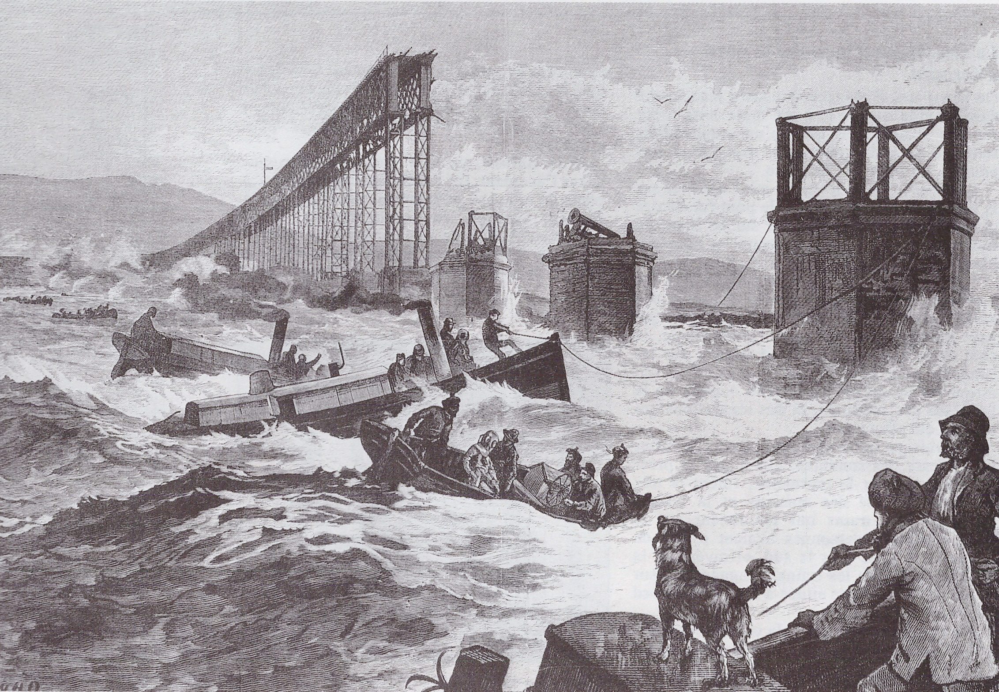
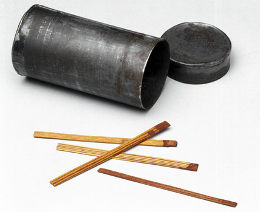
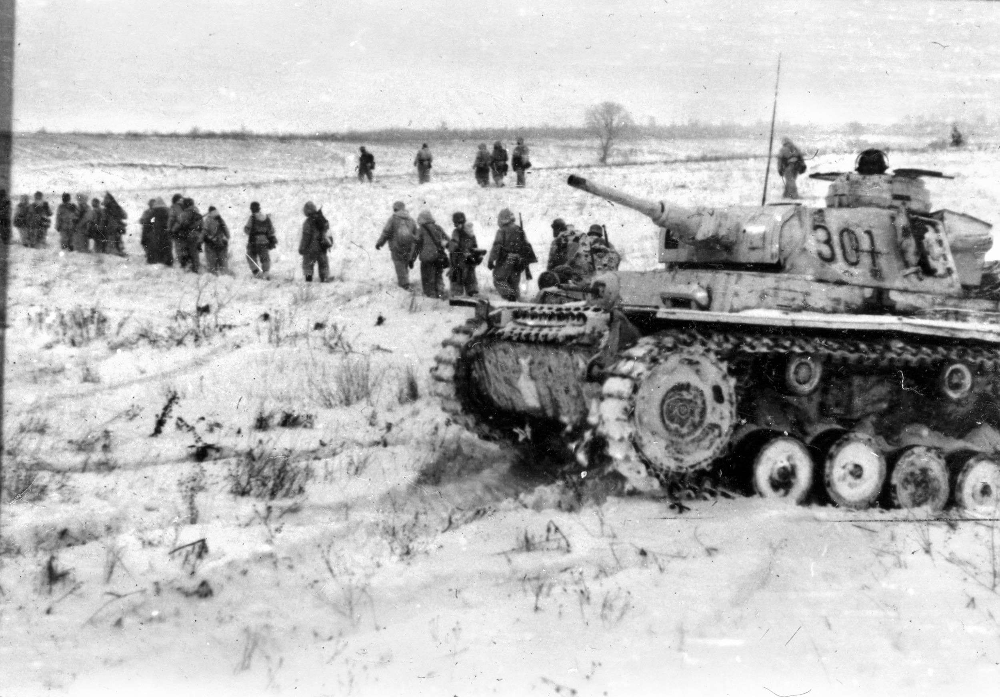
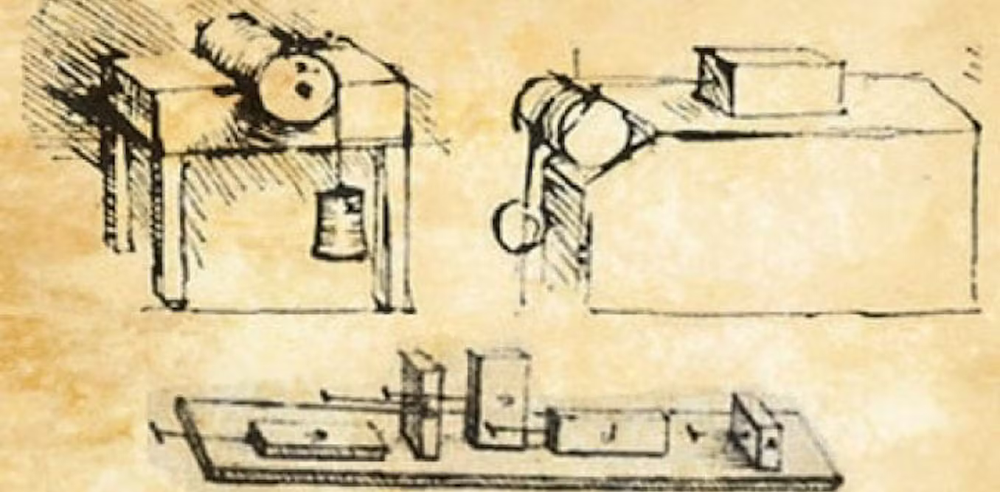
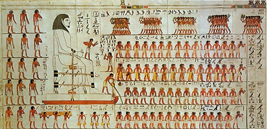
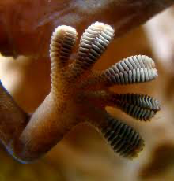

Many school physics courses teach friction in a way that inadvertently fosters confusion. In one lesson, students are told to “ignore air resistance” when solving problems about falling objects or moving cars, treating the world as if friction only exists between solid surfaces. Yet in the very next lesson, they’re taught about parachutists whose survival depends entirely on air resistance, suddenly elevating it from negligible to crucial. This abrupt switch can make friction—and forces in general—seem like arbitrary, context-dependent rules rather than consistent physical principles. Instead of helping students see friction as a family of forces (including air resistance) that always oppose motion, we often isolate topics in a fragmented way, leaving learners unsure when and why certain forces matter...

## Basic Theory

### What is Friction?

-   Friction is the force that **opposes the relative motion** or tendency of motion between two surfaces in contact.
-   It acts **parallel to the surfaces** and opposite to the direction of motion or impending motion.

### Types of Friction

-   **Static Friction (**$F_s$): Acts when surfaces are **not moving** relative to each other. It prevents motion.
-   **Kinetic (Sliding) Friction (**$F_k$): Acts when surfaces **slide past each other**.
-   **Rolling Friction:** Opposes motion when an object rolls over a surface (usually smaller than sliding friction).

### Coefficient of Friction

-   A dimensionless number representing the frictional properties of surfaces.
-   Denoted by:
    -   $\mu_s$ for static friction
    -   $\mu_k$ for kinetic friction

### Frictional Force Formula

-   Maximum static friction force before motion starts: $$
    F_s \leq \mu_s N
    $$
-   Kinetic friction force during sliding: $$
    F_k = \mu_k N
    $$ Where:
-   $N$ = normal force (perpendicular force between surfaces)

### Characteristics of Friction

-   Friction depends on:
    -   Nature of surfaces in contact (material, roughness)
    -   Normal force $N$
-   Friction is **independent of contact area** for solid surfaces.
-   Friction converts kinetic energy into heat.

### Effects of Friction

-   Enables walking, driving, and gripping.
-   Causes wear and tear.
-   Causes energy loss in machines.

### Overcoming Friction

-   Lubrication reduces friction by adding a thin layer between surfaces.
-   Using rollers or ball bearings reduces friction by converting sliding to rolling friction.

### Example: Force Required to Move an Object

If an object of weight $W$ rests on a horizontal surface:

-   Normal force $N = W = mg$
-   Minimum force $F$ to overcome static friction: $$
    F = \mu_s N = \mu_s mg
    $$

### Summary Table

| Quantity | Symbol | Formula | Notes |
|-----------------|-----------------|-----------------|---------------------|
| Static friction force | $F_s$ | $F_s \leq \mu_s N$ | Max value before motion starts |
| Kinetic friction force | $F_k$ | $F_k = \mu_k N$ | During sliding motion |
| Coefficient of friction | $\mu_s, \mu_k$ | Dimensionless | Depends on surfaces |
| Normal force | $N$ | Depends on situation | Usually $N = mg$ on flat surface |

## Stories to enrich

### The Tragedy on the Rails: The Tay Bridge Disaster (1879)

{fig-align="center" width="50%"}

One stormy night in Scotland, a passenger train attempted to cross the Tay Bridge. A violent gust struck, and the bridge collapsed beneath it. Investigators later found that oscillations and lack of lateral frictional damping in the bridge design had allowed the wind to amplify motion until the structure gave way. The disaster shocked Victorian engineers. The need to understand not just force, but friction and resistance within joints and tracks, became a central lesson in civil engineering.

### The Match That Changed the World

{fig-align="center" width="50%"}

In 1826, John Walker invented the friction match—by accident. Stirring a mixture of chemicals with a stick, he noticed the dry blob at the end flared when scraped on stone. This wasn’t heat from fire—it was the mechanical friction of scraping. The invention allowed for easy fire-making for the first time in history. Friction, normally a nuisance to be avoided, became a tool for ignition and survival.

### The Ice of the Battle of Stalingrad

{fig-align="center" width="50%"}

During WWII, German tanks bogged down outside Stalingrad, partly because of brutal cold. The steel tank treads, designed for European mud, couldn’t grip the icy roads. Soviet engineers had reinforced their own equipment with roughened track pads and sandbags for added grip. The frictionless Russian winter became a weapon, turning mobility into paralysis.

### Da Vinci’s Secret Notes on Friction

Long before Newton, Leonardo da Vinci discovered fundamental laws of friction while sketching machines. He wrote (in mirrored script!) that the force of friction is proportional to the load and independent of contact area—ideas later attributed to Amontons. He even created diagrams of inclined planes and sliding blocks. But his findings weren’t published for centuries.

Reflection: How might physics history have changed if da Vinci’s friction laws had been shared?

### The Ancient Egyptian Sled and the Water Trick

Wall paintings show Egyptians hauling giant statues on sleds. Archaeologists puzzled over how they moved such loads. Then, a modern experiment revealed: adding small amounts of water to the sand increased friction’s efficiency by reducing sand displacement and increasing cohesion—making the sled slide more easily. They weren’t just brute-forcing it. They had mastered frictional control. A painting from the tomb of Djehutihotep also depicts someone pouring liquid in front of a sled, supporting this theory. 

Reflection: How can more friction sometimes make things slide more easily?

### The Ice That Was Too Smooth

A group of Gentoo penguins at an aquarium in Hull had to be temporarily removed from their exhibit because new fake ice flooring proved too slippery. 

Staff at The Deep have since installed special anti-slip covering for the seven resident penguins.A staff member said:

>The penguins were taken out of the display on January 6 (2014) to do some routine maintenance work but, when we put them back, the covering did not have enough grip in it for them to stick on to and we had a bit of a skidding situation.

### The Mystery of the Climbing Gecko

{fig-align="center" width="32%"}

Geckos can walk across ceilings, and for years no one knew how. It wasn’t suction or glue—it was molecular friction. Tiny hairs on their feet use van der Waals forces to generate friction at the atomic scale. Engineers now study geckos to make biomimetic pads that let robots and humans stick to glass walls.

### The Violinist’s Rosin

String players rub rosin onto their bows—not to reduce friction, but to create just the right amount. The bow must grip and release the string rapidly to make it vibrate. Too little friction, and there's no sound. Too much, and it scratches. Musicians become masters of microscopic friction control.

## Practical work and Demos

### Ball falling in a tube

Not the most exciting titoe but a great demo. Set up a vertical tube and drop a ping-pong ball into it. The diameter of the tube should be just a little larger than the diameter of the ball. As close as possible is most effective. The ball falls really slowly due to air friction in the tube and quickly reaches terminal velocity.

> Age range: 14-18
>
> Apparatus required: •Large diameter glass tube up to two metres long •Polystyrene balls of various diameters up to almost that of the internal diameter of the glass tube •Stop clock •Ruler

### Glass syringe air bearing

A gas syringe can act like an air bearing when its plunger is fixed and the outer barrel is rotated. By trapping a thin layer of air between the plunger and the barrel wall, the syringe creates a cushion that reduces friction, allowing the barrel to spin smoothly around the stationary plunger. This effect mimics an air bearing’s principle, where pressurized air supports and separates moving parts, enabling low-friction, low-wear rotation. Such a setup can be a useful classroom demonstration of how air bearings work in precision engineering and machinery.

### Lowering friction with magnets

Take a magnet and mount it in a clamp with the poles vertically above each other. Take several clean ball bearings and attach them to the magnet so that they hang in a line from the lower end. Hang enough such that a large washer or other steel disc of about 3 cm in diameter only just able to hang from the end. The disc is supported with minimal friction and by blowing on the side of the disc to set it rotating the disc can be set spinning. With some care in the setup, the disc will spin for over 10 minutes.

> Age range: 11-13
>
> Apparatus required: •Retort stand and clamp •Two or three ball bearings (diameter about 0.8 mm depending on magnet strength) •Strong bar magnet •Steel disc

### Spinning Eggs

Setup: Spin a hardboiled egg and a raw egg horizontally on a table. Touch each to stop it, then release.

Observation: The hardboiled egg stops; the raw egg restarts spinning due to the fluid inside continuing to rotate and dragging on the inside of the shell.

### Stick-slip motion

The stick-slip motion in friction is beautifully illustrated by the sliding woodpecker. This is a small wooden bird fixed to a bead by a short spring. The bead fits loosely over a vertical metal rod. When the bird is still it does not slide down but as soon as it is twanged it slips jerkily down the rod.

> Theory/Explanation:
>
> The hole in the wooden bead is slightly bigger than the diameter of the metal rod. When the hole is vertical the bead slips down but as soon as it tilts, the bead "grips" the rod. The oscillatory motion of the bird on the spring alternately puts the hole upright and at an angle.
>
> Age range: 11-14
>
> Apparatus required: •Woodpecker toy (available from toy suppliers in England)

### Two simple hovercraft

\(a\) Balloon hovercraft

Drill a hole through the centre of a circular disc of hardboard (disc diameter about 10 cm). Stick a rubber bung over the centre of the disc so that the hole in the bung coincides with the hole in the disc. Blow up a balloon and then fit it over the open end of the bung. Air rushes through the hole, and out the other side of the disc and this acts like a small hovercraft. (b) Tile hovercraft

A simple hovercraft can be made really cheaply by using a computer-cooling fan fixed above a hole in a ceiling tile.

> Age range: 11-13
>
> Apparatus required: •Balloon •Hardboard disc with a hole and tube •Ceiling tile •Computer cooling fan

### Falling matchbox

This fascinating short experiment shows you how energy is absorbed by friction. Take a match box---a big one is more impressive and you can leave the matches in it.

Making sure that the box is closed (Photo 1), drop in on to a hard surface from a height of about 10cm. The matchbox will bounce and fall over.

Now pull the drawer out slightly (Photo 2) and repeat the experiment. Once again the matchbox hits the table, but this time the drawer slides in a bit, absorbing some of the energy, and the matchbox should stay upright rather than bouncing.

Age range: 14-18 1 2

> Apparatus required: 'Hard surface
>
> •Matchbox full of matches

### Rolling cans of dog food and baked beans

Get two cans of equal mass --- one containing dog food (or cat food for cat lovers) and the other containing baked beans.

Hold them side-by-side at the top of a ramp and then let them go at the same time asking the class which one will reach the bottom of the slope first.

The can of dog food gets there first because the baked beans are moving within the other can, creating frictional forces which slow down the rate of rotation of that can and so making it roll slower.

Then try two cans of fizzy drink but shake one first. See which one wins in this case.

> Age range: 11-18 depending on treatment
>
> Apparatus required: •Wooden ramp about 1.5 m long •Tins of dog food, baked beans and two of fizzy drink

### Friction between books

A very simple and yet impressive example of friction can be seen using two paper-backed books. It is best done with ones made from rougher poor quality paper.

Hold the books with their open sides facing each other and carefully interleave the pages so that about half of one book extends into half the other as shown by the diagram.

Then get two people to hold the books by their spines and try and pull them apart. There is so much friction between the pages that it is likely that the books will be damaged before they can be pulled apart --- so be careful!

> Age range: 5-14
>
> Apparatus required: •Two paper-backed books

Lifting a 1kg Mass with Rope on a Cylinder

Setup: Tie a 1kg mass (or tin of beans) to thick string. Wrap the string a few times around a rolling pin (or wine bottle).

Question: What happens when the rod is lifted?

Answer: A few turns of rope hold the mass without slipping - this leads onto the next one beautifully…

16. The Falling Cup

Setup: About 1m of string is placed over a pencil with a china cup at one end, close to the pencil. The other longer end is tied to a cork. The string is held just below horizontal.

Question: Will the cup reach the ground when released?

Answer: It stops before it reaches the ground, if the string is measured just right. Conservation of inertia causes the cork to increase in angular velocity as the string shortens. The increased velocity causes the cork to wrap the string round the pencil and thereby provide the friction to slow and stop the cup’s descent.

18. Coin and Paper Drop

Drop separately, then drop with paper side-on and next to coin, finally drop with coin on top of paper, but close.

Observations:

Coin lands first - it has a higher terminal velocity.

Both land together, if paper continues to fall edge-on.

Coin first, paper slips off.
