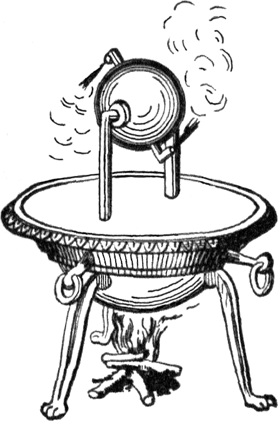
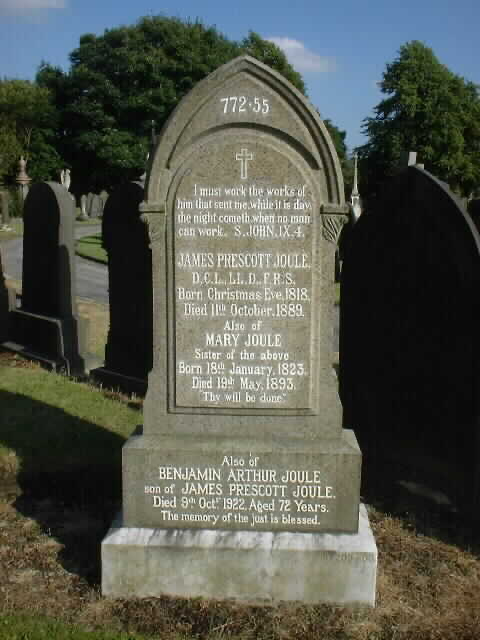

General theory for this section:

## Work, Energy, and Power: Basic Theory

### Work ($W$)

-   Work is done when a force causes displacement: $$
    W = F d \cos \theta
    $$ Where:

-   $F$ = applied force (N)

-   $d$ = displacement (m)

-   $\theta$ = angle between force and displacement

-   Units: joules (J), where $1\,\text{J} = 1\,\text{N·m}$

-   **No work is done** if there is:

    -   No displacement
    -   Force perpendicular to displacement (e.g. circular motion)

### Energy

-   **Energy** is the capacity to do work.

#### Kinetic Energy ($E_k$)

-   Energy of a moving object: $$
    E_k = \frac{1}{2} m v^2
    $$ Where $m$ is mass (kg) and $v$ is speed (m/s)

#### Gravitational Potential Energy ($E_p$)

-   Energy due to position in a gravitational field: $$
    E_p = m g h
    $$ Where $g = 9.8\,\text{m/s}^2$ (on Earth), $h$ is height (m)

#### Elastic Potential Energy

-   Stored in stretched/compressed springs: $$
    E = \frac{1}{2} k x^2
    $$ Where $k$ is spring constant (N/m), $x$ is extension/compression (m)

### Conservation of Energy

-   **Total energy is conserved** in a closed system: $$
    \text{Total energy in} = \text{Total energy out}
    $$
-   Energy can be transformed (e.g. potential ↔ kinetic) but not created or destroyed.

### Power ($P$)

-   Power is the rate of doing work or transferring energy: $$
    P = \frac{W}{t} = \frac{E}{t}
    $$ Where:

-   $W$ = work done (J)

-   $t$ = time (s)

-   Units: watts (W), where $1\,\text{W} = 1\,\text{J/s}$

### Alternative expressions:

-   If an object is moving at constant speed under constant force: $$
    P = F v
    $$

### Efficiency

-   A measure of how much input energy is usefully transferred: $$
    \text{Efficiency} = \frac{\text{useful output energy}}{\text{input energy}} \times 100\%
    $$

### Summary Table

| Concept | Formula | Units |
|----|----|----|
| Work | $W = F d \cos \theta$ | joule (J) |
| Kinetic Energy | $E_k = \frac{1}{2} m v^2$ | joule (J) |
| Gravitational Potential | $E_p = m g h$ | joule (J) |
| Elastic Potential Energy | $E = \frac{1}{2} k x^2$ | joule (J) |
| Power | $P = \frac{E}{t}$ or $P = F v$ | watt (W) |
| Efficiency | $\frac{\text{useful}}{\text{input}} \times 100\%$ | percent (%) |

## Stories to enrich

### Hero’s Steam Engine: The First Work Done by Steam

{fig-align="center" width="50%"}

Though called Hero's engine, Vitruvius's (c. 80 BC – c. 15 BC) was the first to mention aeolipiles by name:

> Aeolipilae are hollow brazen vessels, which have an opening or mouth of small size, by means of which they can be filled with water. Prior to the water being heated over the fire, but little wind is emitted. As soon, however, as the water begins to boil, a violent wind issues forth.\[6\]

Hero (c. 10–70 AD) takes a more practical approach, in that he gives instructions how to make one:

> PLACE a cauldron over a fire: a ball shall revolve on a pivot. A fire is ignited under a cauldron, A B, (fig. 50), containing water, and covered at the mouth by the lid C D; with this the bent tube E F G communicates, the extremity of the tube being fitted into a hollow ball, H K. Opposite to the extremity G place a pivot, L M, resting on the lid C D; and let the ball contain two bent pipes, communicating with it at the opposite extremities of a diameter, and bent in opposite directions, the bends being at right angles and across the lines F G, L M. As the cauldron gets hot it will be found that the steam, entering the ball through E F G, passes out through the bent tubes towards the lid, and causes the ball to revolve, as in the case of the dancing figures.

Rather oddly it appears that nobody thought to do anything with these machines for *centuries* after this. Their main use appears to have been a curio displayed in temples.

### James Joule's Honeymoon

James Joule, whose name we use for the unit of energy, was so passionate about energy conservation that he ran an experiment on his honeymoon. While visiting the Alps in 1847, Joule measured the temperature rise of water at the bottom of a waterfall, testing whether the mechanical energy of the falling water converted to heat. His findings supported the idea that mechanical work and heat were two forms of the same thing — energy. His new bride, according to some accounts, may not have been quite as enthusiastic about the experiment.

### James Watt and the Horsepower Revolution

James Watt improved the steam engine in the 18th century and coined the term horsepower to describe engine power relative to draft horses. His work transformed energy from a natural force into a measurable quantity used in industry. This idea helped quantify how much work engines could do, fueling the Industrial Revolution. His improvements were so successful that, along with his commercial partner, Watt quickly built a thriving company that supplied steam-driven pumps to mines.

Amusingly the volume of paperwork he was faced with increased hugely and Watt struggled to find enough clerks to copy the documents of buisness. He did what any frustrated inventor would do and, along with Joseph Black, Watt invented the first copier.

The first copy of a document was written in a gelatinous ink which was then dampened and pressed against another thin sheet by passing the two documents between two rollers. Tough the copy was only legible if read through the back of the copied sheet it produced a usable "photocopy". Watt patented the device and sold 200 of the copiers in their first year of manufacture including a number to Thomas Jefferson

### The Falling Weight: Joule’s Paddle Wheel Experiment

James Prescott Joule carefully measured how much work was done by falling weights to stir water, observing temperature changes. This experiment linked mechanical work with heat energy, laying the foundation for the conservation of energy principle. It showed that energy could be transformed but not destroyed.

The paddle-wheel experiment seems to be straightforward, but attempts to replicate it from Joule’s methodological description highlight either his prowess as an experimental scientist or his talents for inventive description. Joule’s instructions require an experimenter to use pulleys to raise and then drop two 13 kg masses 20 times within a 35-minute period. Between each winding, the experimenter must pause to take temperature readings from behind a wooden shield to prevent heating by their body affecting the experiment.

His gravestone, in Sale, Greater Manchester, has the number 772.55 engraved on it, the magnitude of work required to heat a pound of water by one degree in foot-pounds.

{fig-align="center"}

### The Boiling Amazon

For hundreds of years, legends spoke of a boiling river in the Amazonian jungle. In 2011, geoscientist Andrés Ruzo rediscovered and began studying the river. The average temperature of the water is 86°C and is heated by hot springs powered by geological fault lines.



### The Human Body: A Power Plant

The average human at rest produces about 100 watts of power—roughly the same as a light bulb. But a sprinter can output over 1,000 watts in a short burst. Our bodies convert chemical energy from food into mechanical work and heat. Understanding this helped develop sports science and ergonomics.

| **Activity** | **Energy expenditure (kJ per hour per kg of body mass)** |
|----|----|
| Talking or talking on the phone, reclining | 4 |
| Occupation, office work in general | 6 |
| Studying, general, including reading and/or writing (sitting) | 7.5 |
| Washing dishes | 9 |
| Shopping (non-grocery shopping, walking) | 9 |
| Playing snooker/pool | 10 |
| Walking using crutches | 17 |
| Playing drums | 17 |
| Table tennis, ping pong | 17 |
| Swimming, backstoke | 33 |
| Football, competitive | 42 |
| Swimming, crawl, fast | 46 |

## Practical work and Demos

### Cars and carpet

One of the misconceptions that appears commonly is the need to push an object to cause it to move, as opposed to accelerating it. This comes about principally due to our experience of everything suffering friction. A very nice demonstration of work done against friction is in the braking of a toy car or trolley as it rolls down a ramp on to a piece of carpet. By measuring the stopping distance, and the energy involved, one can find the braking force. This can be done by either measuring the loss of potential energy as it runs down the ramp and on to the carpet or finding the loss of kinetic energy by measuring its speed with a light gate as it reaches the carpet.

Simmilar things can be done by comparing the height drop of the cresta-run with the final velocity of the sledders. In many parts of the UK you'll see escape lanes filled with gravel at the sides of steep hills to stop runaway traffic. There are some spectacular videos of these in action on youtube.



For a car of mass m travelling down a ramp from a height h and reaching a speed v at the bottom:

Loss of kinetic energy as it brakes to a stop on the carpet = Braking force (F) x Braking distance (d)

Potential energy lost in travelling down the ramp = mgh

If we assume that this is all converted to kinetic energy then mgh = Fd

If we use the velocity and therefore the kinetic energy at the base of the ramp then we can ignore the effect of friction on the the ramp.

$$ \text{Kinetic energy} = 1/2 mv^{2} = Fd$$

::::::: {.callout-note collapse="true"}
## Practical Info:

:::::: columns
::: {.column width="45%"}
**Equipment**

-   Traditional lab trolleys or some larger toy cars work best
-   Ramps
-   Squares of carpet/a carpeted room
-   Rulers

Optional: - Lightgates - Stopwatches
:::

::: {.column width="10%"}
<!-- empty column to create gap -->
:::

::: {.column width="45%"}
**Age range / Keystage**

KS3:  {{\< fa star \>}}

KS4:   

KS5:   
:::
::::::
:::::::

### Crumple zones

I like to illustrate the crumple-zone with a little competition. I place a solid block at the base of a ramp down which cars can be rolled. Students have eg. 20 minutes, a meter of tape and 5 sheets of A4 paper with which to reduce the impact of the car on the block. It's fun to measure this with an accelerometer (you could use a phone and phy-phox) or a force meter. For a less precise (but more fun version) challenge students to protect an egg passenger on the top of the cart.

Either way there's lots of opportunity to relate GPE to KE to work done and link these ideas with impulse and newton's second law.

The speed ($v$) at which the cylinder (crumple zone) hits the floor (a solid block) can be found from: $$ v = \sqrt{2gh} $$

where:

-   $h$ is the high fallen and
-   $g$ is the acceleration due to gravity (9.81 $ms^{-2}$).

::::::: {.callout-note collapse="true"}
## Practical Info:

:::::: columns
::: {.column width="45%"}
**Equipment**

-   Traditional lab trolleys or some larger toy cars work best
-   Ramps
-   Materials for crash barriers/crumple zones
-   Egg

Optional: - Datalogging forcemeter
:::

::: {.column width="10%"}
<!-- empty column to create gap -->
:::

::: {.column width="45%"}
**Age range / Keystage**

KS3:  {{\< fa star \>}}

KS4:   

KS5:   
:::
::::::
:::::::

### Are you more powerful than Yoda?

The core of this investiagation is a classic experiment to measure a pupil's power - they carry their own mass (themselves) up a known height. The pupils run up a flight of stairs of known height and measure the time that they take to do it. They then can measure their own weight or use "the international standard physicist mass[^workenergypower-1]" of 80Kg and so calculate the work done and the power that they developed. Carrying a rucksack loaded with books will increase their weight.

[^workenergypower-1]: Yes, I made it up but it's good to allow students to avoid mass/self image issues.

The second part of this was inspired by the wonderful <https://what-if.xkcd.com/3/>. In turn that was inspired by the great SMBC comic exploring the geopolitical consequences of having Superman turn a crank to provide an unlimited source of energy.

Yoda’s greatest display of raw power in the original trilogy came when he lifted Luke’s X-Wing from the swamp. As far as physically moving objects around goes, this was easily the biggest expenditure of energy through the Force we saw from anyone in the trilogy.

I tend to walk the students through the following fermi-problem:

The energy it takes to lift an object to height h is equal to the object’s mass times the force of gravity times the height it’s lifted. The X-Wing scene lets us use this to put a lower limit on Yoda's peak power output.

First we need to know how heavy the ship was. The X-Wing’s mass has never been canonically established, but its length has—12.5 meters. An F-22 is 19 meters long and weighs 19,700 kg, so scaling down from this gives an estimate for the X-Wing of about 12,000 lbs (5 metric tons).

Next, we need to know how fast it was rising...

We go over footage of the scene (lots of sources on youtube) and we time the X-Wing's rate of ascent as it was emerging from the water. The front landing strut rises out of the water in about three and a half seconds, and I estimate the strut to be 1.4 meters long (based on a scene in A New Hope where a crew member squeezes past it), which tells us the X-Wing was rising at 0.39 m/s.

Lastly, we need to know the strength of gravity on Dagobah. Wookieepeedia has a catalog of such things and informs us that the surface gravity on Dagobah is 0.9g. Combining this with the X-Wing mass and lift rate gives us our peak power output:

Note that in the experiment it's advisable to only allow one pupil at a time to run up the stairs. A slope is better if you have one available. I always give a good warning about taking care, wearing sensible footwear etc. If you think your class are likely to be over enthusiastic which would lead to falls and injuries, please skip this. An accessible alternative is to lift a heavy mass through a measured distance with one or two hands, again the mass should be light enough to not cause injury and no pupil should lift a weight higher than their own shoulders. Warn of back damage here.

::::::: {.callout-note collapse="true"}
## Practical Info:

:::::: columns
::: {.column width="45%"}
**Equipment**

-   Stairs
-   Rulers
-   Stopwatches

Optional: - Scales (you can buy scales that read in Newtons which can help get past the issues of mass-sensitivity)
:::

::: {.column width="10%"}
<!-- empty column to create gap -->
:::

::: {.column width="45%"}
**Age range / Keystage**

KS3:  {{\< fa star \>}}

KS4:   

KS5:   
:::
::::::
:::::::
