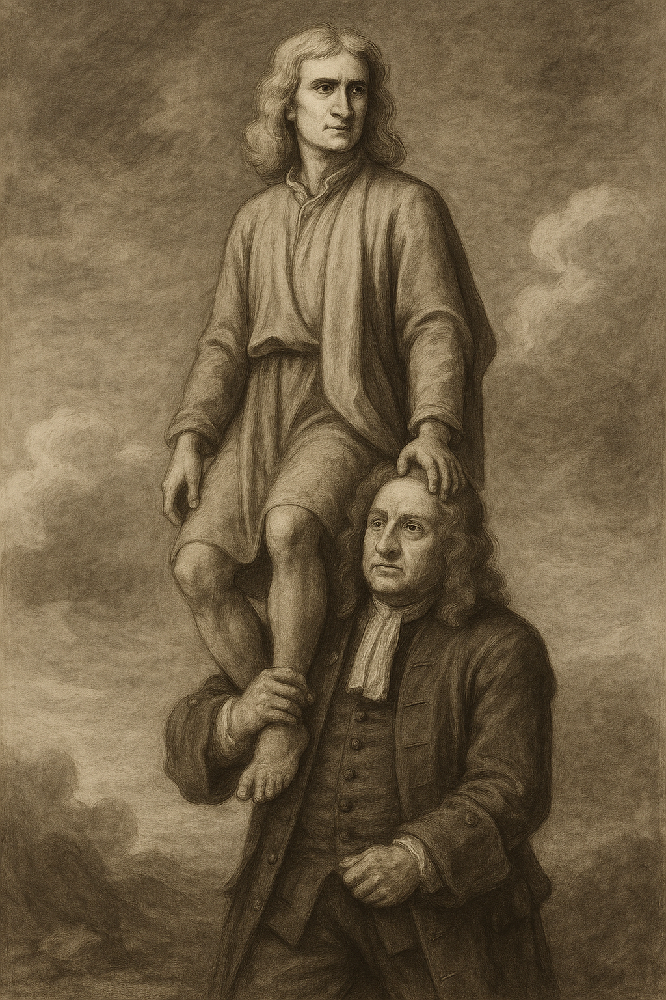

# Preface {.unnumbered}

This collection of physics teaching demonstrations is a celebration of the creativity, rigour, and generosity that have long characterised the physics education community. These demos are not merely tricks or spectacles—they are carefully chosen moments of insight, capable of transforming a dry formula into an unforgettable experience.

The work has been inspired and informed by many outstanding educators whose contributions have shaped the way physics is taught in classrooms across the UK and beyond. I would like to acknowledge, in particular, the **Institute of Physics (IoP)**, whose sustained support for teachers and resources continues to be a cornerstone of excellence in science education.

I also owe a great debt to the legendary **Keith Gibbs**, whose *Physics Ideas* and *SchoolPhysics* websites have long been a treasure trove of practical demonstrations, teaching insights, and wisdom. His generosity in sharing his work has helped generations of teachers inspire curiosity and wonder in their students.

Thanks are also due to **David Featonby**, whose international outreach and tireless promotion of creative practical physics has brought joy and insight to educators and students alike.

I gratefully acknowledge **David Cotton**, whose enthusiasm for physics communication and mastery of both digital and practical resources continues to inspire innovation in the classroom.

Finally, I thank **Norman Warren**, whose clear, insightful teaching and deep pedagogical experience have helped to make physics accessible, relevant, and exciting for generations of students.

This book ***stands on the shoulders of these giants***—and hopes, in some small way, to carry their spirit forward.

Ok - I can't resist, you'll have to get used to this...

## Standing on the Shoulders of Giants: A Phrase, a Philosophy, and a Historical Debate

The phrase *“standing on the shoulders of giants”* is one of the most famous expressions of intellectual humility and gratitude. It reminds us that progress in science, education, and knowledge is never created in isolation but builds upon the discoveries and insights of those who came before us.

{fig-align="center" width="50%"}

## The Origin and Meaning

The phrase is most famously attributed to **Isaac Newton**, who wrote in a letter to Robert Hooke in 1675:

> *“If I have seen further it is by standing on the shoulders of giants.”*

Newton was acknowledging that his breakthroughs were possible because of the foundational work done by earlier scientists like Galileo, Kepler, and Hooke himself. The metaphor conveys the idea that we can see further—understand more—when we build on the vast achievements of past thinkers.

However, this phrase was not coined by Newton. It has medieval roots, appearing as early as the 12th century with the philosopher Bernard of Chartres, who likened scholars to dwarfs perched on the shoulders of giants, able to see more and farther than they could on their own.

## Teaching and Science: A Shared Tradition

In physics teaching, this phrase carries special weight. Demonstrations, experiments, and explanations we use today are the result of centuries of collective insight and innovation. By sharing these with students, we pass on not only facts but a lineage of curiosity, discovery, and wonder.

## The Newton-Hooke Rivalry: Was It a Slur?

The phrase’s context is sometimes viewed through a more contentious lens. Newton’s relationship with Robert Hooke was complicated—marked by moments of cooperation but also rivalry and disagreement over scientific credit.

Some have speculated that Newton’s phrase was a subtle dig at Hooke. Their reasoning includes:

-   **Hooke’s Physical Stature:** Hooke was reportedly short and possibly physically deformed, which leads some to interpret the saying as a veiled short-joke at Hooke's expense. Given their clashes over priority and ideas, the compliment might have been sarcastic.
-   **Newton’s Other Correspondence:** Newton was very dismissive, insulting and, cold towards Hooke elsewhere.

### But What Does the Evidence Say?

Most historians disagree with the idea that Newton was insulting Hooke with this phrase. Instead, they point out:

-   The metaphor was a common expression of humility and respect well before Newton.
-   The full letter shows Newton acknowledging Hooke’s important contributions.
-   There is no explicit insult or mocking language in the letter.
-   Newton acknowledged other giants openly and genuinely.

In fact, the phrase fits more as a respectful nod to the continuum of knowledge rather than a veiled slur.

## Why Does It Matter?

It doesn't specially - but understanding what was meant by *“standing on the shoulders of giants”* helps us appreciate the collaborative nature of science. It reminds educators and students alike that learning is a shared journey. Each new insight, each “aha” moment, is built on a foundation laid by others.

Rather than focusing on personal rivalries, the phrase encourages humility, gratitude, and inspiration to push the boundaries further.

## Final Thoughts

Whether in the lecture theatre, the lab, or the classroom, the spirit of *standing on the shoulders of giants* invites us to see beyond ourselves and to contribute, one day, to the shoulders upon which future generations will stand.

## References

1.  Whiteside, D.T. (1959). *The Mathematical Papers of Isaac Newton, Volume 1: 1664–1691*. Cambridge University Press.

2.  Westfall, R. S. (1980). *Never at Rest: A Biography of Isaac Newton*. Cambridge University Press.

3.  Dobbs, B. J. T. (1991). *The Foundations of Newton’s Alchemy, or “The Hunting of the Greene Lyon”*. Cambridge University Press.

4.  Westfall, R. S. (2002). *Science and Religion in Seventeenth-Century England*. Yale University Press.

5.  Jardine, L. (2019). *The Curious Life of Robert Hooke: The Man Who Measured London*. HarperCollins. (This is a particularly good book if you are interested in Hooke)

6.  Bernard of Chartres (c. 1130). As cited in John of Salisbury, *Metalogicon* (1159).

7.  Cohen, I. B. (1999). *The Birth of a New Physics*. W. W. Norton & Company.

8.  Shapiro, B. J. (2007). “Newton and Hooke: The Private Relationship Behind the Public Rivalry.” *Physics Today*, 60(3), 42–47.
